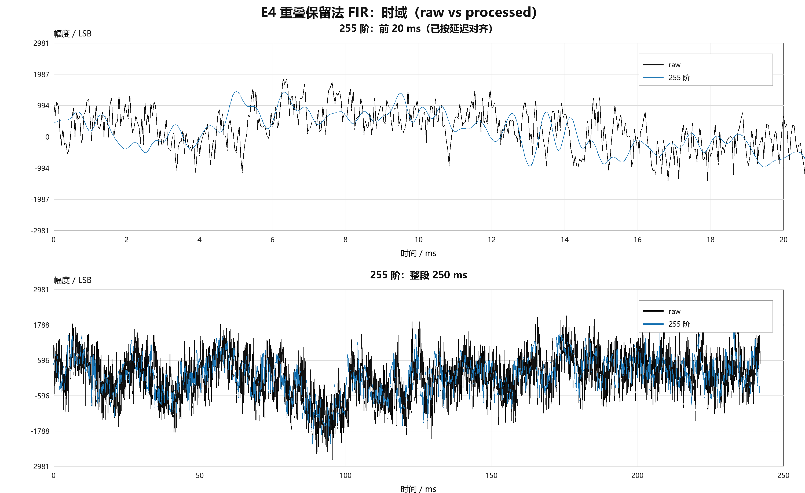
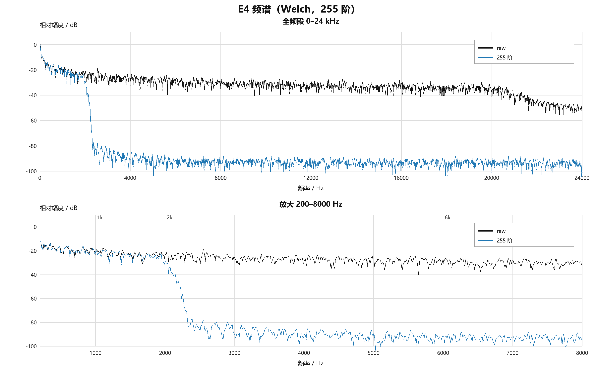
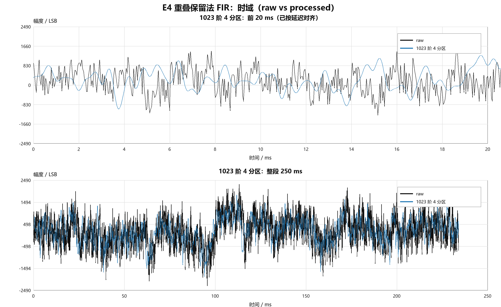
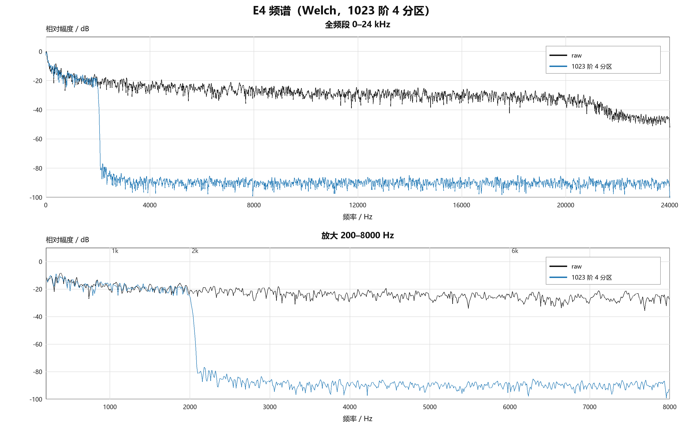
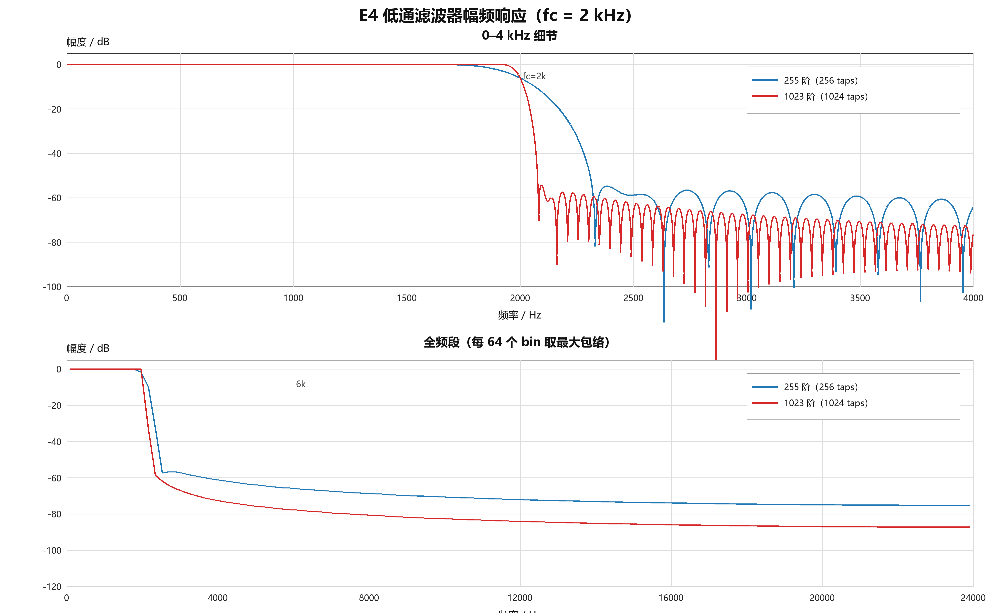
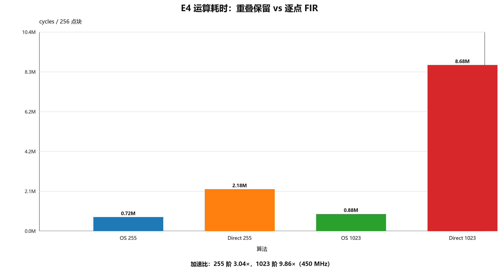

# E4 重叠保留法 FIR：导出数据分析

> 数据：`data_256` / `data_1024`，48 kHz、250 ms（12000 点），CCES 导出，每行一个字节（小端）。

## 1. 采集模式与数据规模

| 目录 | 实时模式 | 采样点 | 说明 |
|---|---:|---:|---|
| data_256 | 255 阶（256 taps） | 12000 | `gProcessed1024Capture` 为 0 |
| data_1024 | 1023 阶（4×256 分区） | 12000 | `gProcessedCapture` 与 `gProcessed1024Capture` 相同 |

## 2. 运算耗时（启动时 5 块平均，256 点/块）

| 算法 | cycles/块 | cycles/点 | μs/块（450 MHz） | 加速比 |
|---|---:|---:|---:|---:|
| OS 255 | 716,173 | 2797.6 | 1591.5 | — |
| Direct 255 | 2,178,214 | 8508.6 | 4840.5 | 3.04× |
| OS 1023 | 880,283 | 3438.6 | 1956.2 | — |
| Direct 1023 | 8,678,553 | 33900.6 | 19285.7 | 9.86× |

处理块数：421；采样率：48000 Hz。

## 3. 精度（重叠保留 vs 同阶逐点 FIR）

| 模式 | 最大相对误差 | 最大绝对误差 / LSB |
|---|---:|---:|
| 255 阶 | 4.035e-06 | 0.070 |
| 1023 阶 | 2.912e-06 | 0.156 |

## 4. 频谱与滤波效果（Welch，4096 点，Hann）

| 频率 | 256 raw / dB | 256 proc / dB | 256 实测衰减 | 1024 raw / dB | 1024 proc / dB | 1024 实测衰减 | 理论 256 | 理论 1024 |
|---:|---:|---:|---:|---:|---:|---:|---:|---:|
| 1000 Hz | 19.8 | 19.3 | -0.6 dB | 15.5 | 19.5 | 4.0 dB | -0.0 dB | -0.0 dB |
| 2000 Hz | 15.8 | 10.2 | -5.6 dB | 14.6 | 11.3 | -3.4 dB | -6.0 dB | -6.0 dB |
| 6000 Hz | 11.2 | -52.5 | -63.8 dB | 11.8 | -52.5 | -64.3 dB | -80.4 dB | -92.6 dB |

说明：实测衰减为 processed/raw 的 Welch 谱线比；6 kHz 受采集噪声底限制，约 -64 dB；滤波器理论阻带为 -80 / -92 dB。输入本身含明显低频哼声和幅度起伏，1 kHz 的 raw/proc 差值会受输入幅度变化影响，滤波器增益以理论列为准。

## 5. 结论

- 255 阶 OS 约 0.716M cycles/块（1.59 ms），比逐点 255 阶快 3.04×；
- 1023 阶 4 分区 OS 约 0.880M cycles/块（1.96 ms），比逐点 1023 阶快 9.86×；
- 2 kHz 在截止点理论约 -6 dB（实测 -3.4~-5.6 dB，受输入幅度起伏影响）；
- 6 kHz 实测被压约 64 dB，受采集噪声底限制；滤波器理论阻带为 -80 / -92 dB；
- 1 kHz 理论 0 dB；实测 raw/proc 差值受输入幅度波动影响，1024 模式甚至为正，滤波器增益以理论响应为准；
- 输入含明显低频哼声，低通滤波器会保留这部分低频，因此 processed 波形仍保留慢变分量；
- 重叠保留输出与同阶逐点 FIR 的最大相对误差在 1e-6 量级，算法一致。
