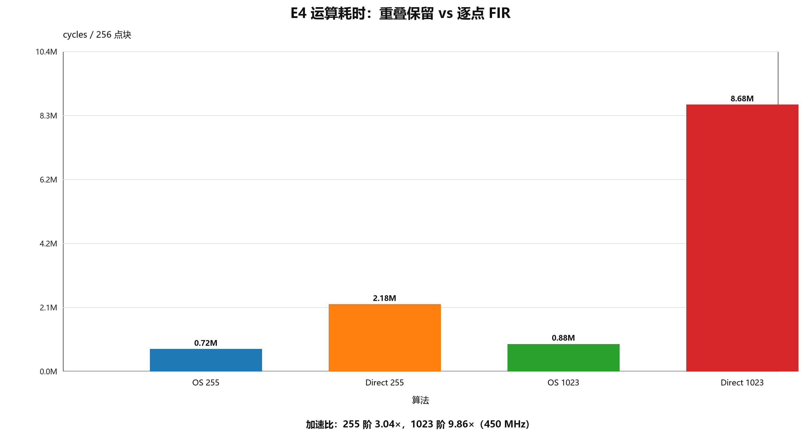
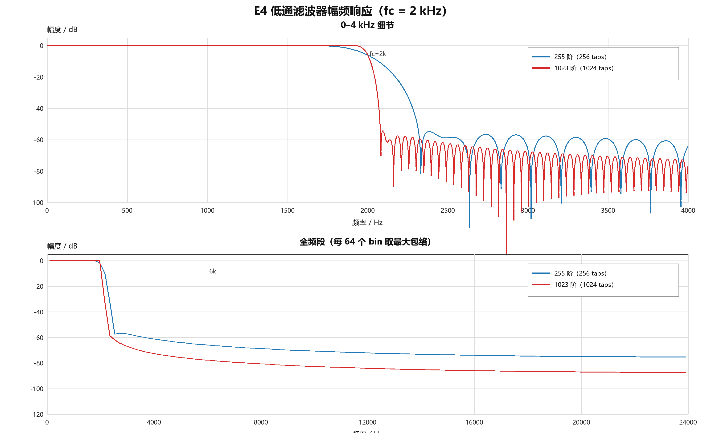
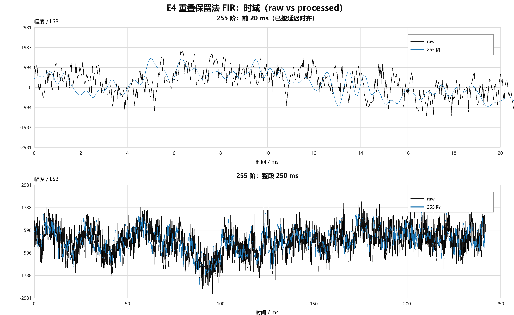
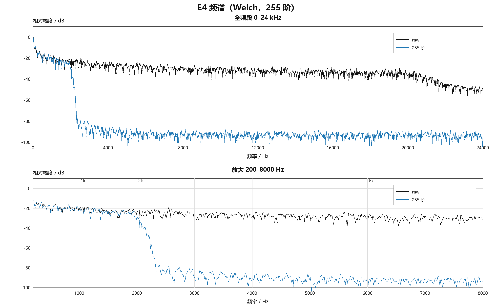
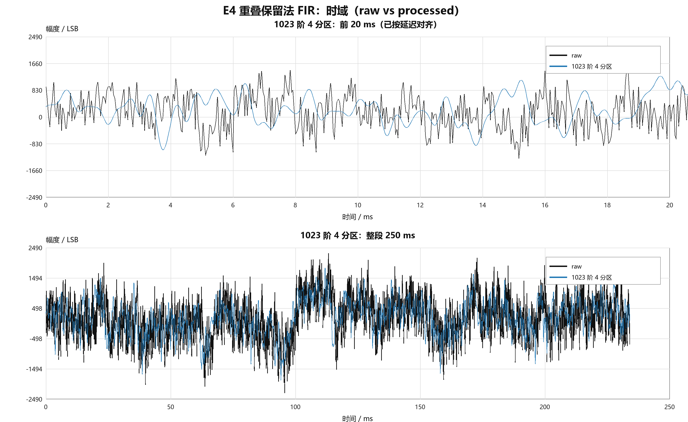
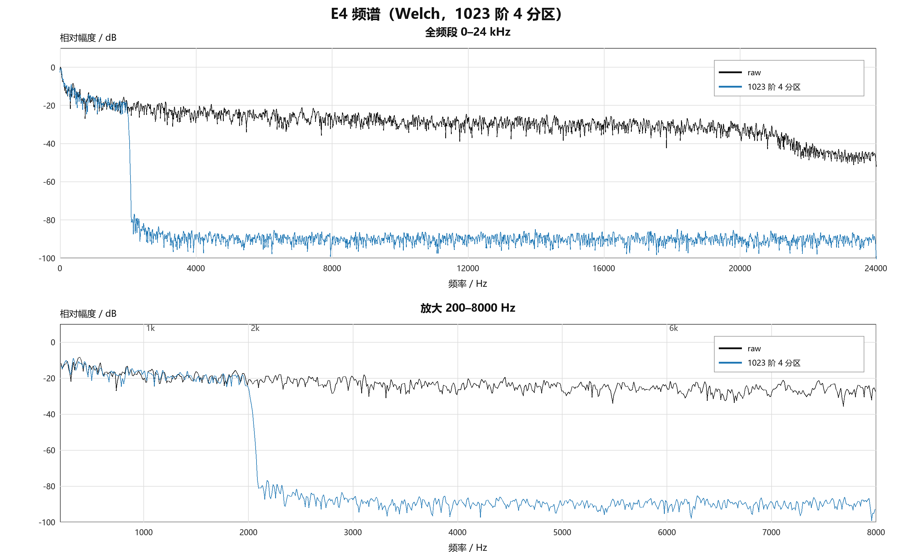

# E4 实验报告

> 231840287 黄杨洲 南京大学 声学

> 课堂记录：
>
> 1. 重叠保留法用“分帧 + FFT”把长序列卷积变成频域乘法，帧长取滤波器长度的 2 倍，帧移取滤波器长度，相邻帧重叠 50%。
> 2. 每帧 IFFT 后，前一半被循环卷积的尾部污染，丢掉；后一半才是本帧的线性卷积结果。
> 3. 比较重叠保留法和逐点时域 FIR 的运算量；进阶要求把 1 个 1023 阶 FIR 拆成 4 个 255 阶分区。

## 实验要求与分析

### 要求

- 基于重叠保留法实现实时 FIR 滤波；
- FIR 滤波器阶数 **255 阶**（256 个系数），PPT 给定信号处理采样率 **16 kHz**；
- 比较重叠保留法 FIR 与逐点时域 FIR 的运算效率；
- 进阶要求：把 1 个 **1023 阶** FIR 拆成 **4 个 255 阶** FIR 分区实现。

### 分析

本实验的核心是把“逐点滑动”的长 FIR 换成“分帧 FFT”的块处理：

- 帧长 \(N=512\)，滤波器长度 \(L=256\)，帧移 \(hop=L=256\)，相邻帧重叠 50%；
- 每帧做一次 512 点 FFT，乘滤波器频响 \(H\)，再做 IFFT；
- IFFT 结果的前 256 点丢弃，后 256 点作为本帧输出；
- 逐点 FIR 作为对照：每输出一个样本做 256 次乘加；进阶时做 1024 次乘加。

**关于采样率**：PPT 的要求是 16 kHz，但现有 ADC/DAC 板卡的驱动和缓冲区是按 48 kHz 配置的，`SAMPLES_PER_PERIOD = 48000/3000 = 16`；如果直接把 `SAMPLE_RATE` 改成 16000，这个值会变成 5，缓冲区、E2/E3 的节拍和 ADC 配置都会被破坏。因此本实现**直接在 48 kHz 上做重叠保留**，算法参数 \(N=512\)、\(hop=256\)、\(L=256\) 不变；48 kHz 下帧长 10.67 ms、帧移 5.33 ms。若以后要严格按 16 kHz 运行，只需在 E4 前后各加一级 3:1 抽取/插值，重叠保留的主体代码不用改。

## 理论解释

### 重叠保留法

设滤波器长度为 \(L\)，帧长为 \(N=2L\)，帧移为 \(L\)。第 \(m\) 帧的输入为

\[
\mathbf{x}_m=[x((m-1)L),\ldots,x((m+1)L-1)]^T
\]

把它补成 \(N\) 点，做 FFT：

\[
\mathbf{X}_m=\mathrm{FFT}_{N}(\mathbf{x}_m)
\]

滤波器补零到 \(N\) 点后的频响为 \(\mathbf{H}\)，则

\[
\mathbf{y}_m=\mathrm{IFFT}_{N}(\mathbf{X}_m\odot\mathbf{H})
\]

由于 FFT 对应的是**循环卷积**，\(\mathbf{y}_m\) 的前 \(L\) 点混入了帧尾的循环卷绕，只有后 \(L\) 点等于线性卷积的结果：

\[
y[mL+n]=y_m[L+n],\qquad n=0,\ldots,L-1
\]

所以每帧丢掉前 \(L\) 点、保留后 \(L\) 点，这就是“重叠保留”。

PPT 第 4 页用 \(L=32\)、\(N=64\)、帧移 32 举例；本实验把长度放大 8 倍，取 \(L=256\)、\(N=512\)、帧移 256。

### 运算量对比

逐点时域 FIR 每个输出样本需要 \(L\) 次乘加：

\[
C_{\text{direct}}\approx L\quad \text{MAC/sample}
\]

重叠保留法每 \(L\) 个输出样本需要：

- 1 次 \(N\) 点 FFT；
- 1 次 \(N\) 点复数乘法；
- 1 次 \(N\) 点 IFFT。

其运算量约为

\[
C_{\text{OS}}\approx \frac{2\cdot \frac{N}{2}\log_2 N + N}{L}
=\frac{N\log_2 N + N}{L}\quad \text{复数运算/sample}
\]

当 \(L=256,N=512\) 时，重叠保留法把 \(O(L)\) 的逐点乘加换成了 \(O(\log N)\) 的 FFT 运算；当滤波器更长（1023 阶、1024 个系数）时，优势更明显。

### 1023 阶的 4 分区实现

把 1024 个系数分成 4 段，每段 256 个：

\[
h_p[i]=h[i+256p],\qquad i=0,\ldots,255,\quad p=0,\ldots,3
\]

则

\[
y(n)=\sum_{p=0}^{3}\sum_{i=0}^{255}h(i+256p)\,x(n-i-256p)
\]

频域实现为

\[
\mathbf{Y}_m=\sum_{p=0}^{3}\mathbf{X}_{m-p}\odot\mathbf{H}_p
\]

其中 \(\mathbf{H}_p\) 是第 \(p\) 段 256 个系数补零到 512 点后的 FFT。这样每帧仍然只做 1 次 FFT + 1 次 IFFT，只是多做了 3 次频域乘加，就把滤波器长度从 256 扩展到 1024。

### 滤波器设计

两组滤波器都采用 Hamming 窗低通：

\[
h[n]=\mathrm{sinc}\!\left(\frac{2f_c}{f_s}\left(n-\frac{M}{2}\right)\right)
\left(0.54-0.46\cos\frac{2\pi n}{M}\right),\quad M=\text{taps}-1
\]

再归一化到 \(\sum h[n]=1\)。取 \(f_s=48\) kHz、\(f_c=2\) kHz：

- 255 阶（256 taps）：2 kHz 处约 -6 dB，6 kHz 处理论 -80.4 dB；
- 1023 阶（1024 taps）：2 kHz 处约 -6 dB，6 kHz 处理论 -92.6 dB。

512 点 FFT 采用基-2 时间抽取，旋转因子在初始化时一次算好；IFFT 用“共轭—FFT—共轭—乘 \(1/N\)”实现。

## 实验方法与实现

### 基本控制方式

和 E1/E2/E3 一样，在 `adc_dac_playback.h` 末尾用宏选择 E4 代码块，并用两个模式宏分两次采集：

```c
// E4
#define E4_OVERLAP_SAVE

//#define E4_MODE_1024         /* 第二次采数据：1023 阶 4 分区 */
#ifndef E4_MODE_1024
#define E4_MODE_256            /* 第一次采数据：255 阶 */
#endif
```

- 第一次：只实时跑 255 阶，采 `data_256`；
- 第二次：把 `E4_MODE_1024` 的注释去掉，只实时跑 1023 阶 4 分区，采 `data_1024`。

两套滤波器的逐点 FIR 耗时/误差仍然在启动时一起测，所以两次的 `gE4Timing` 都包含 OS256 / Direct256 / OS1024 / Direct1024 四组数据。

### 新增 `overlap_save_fir.h`

头文件里集中实现：

- 512 点 FFT / IFFT；
- Hamming 窗低通设计；
- `E4_OS256`：255 阶重叠保留 + 逐点 FIR 对比；
- `E4_OS1024`：1023 阶 4 分区重叠保留 + 逐点 FIR 对比；
- 状态历史、频响表、工作缓冲区。

关键参数：

```c
#define E4_FFT_N     512
#define E4_HOP       256
#define E4_TAPS1     256
#define E4_TAPS2     1024
#define E4_PART      4
#define E4_PART_TAPS 256
```

255 阶重叠保留的核心：

```c
for (i = 0; i < E4_HOP; i++) {
    w->frame[i]         = s->x_hist[i];   /* 上一帧 */
    w->frame[E4_HOP + i] = x[i];          /* 本帧新数据 */
}

e4_fft_real(w->frame, w->X);

for (i = 0; i < E4_FFT_N; i++) {
    w->Y[i].re = w->X[i].re * s->H[i].re - w->X[i].im * s->H[i].im;
    w->Y[i].im = w->X[i].re * s->H[i].im + w->X[i].im * s->H[i].re;
}

e4_ifft_cplx(w->Y);

for (i = 0; i < E4_HOP; i++) {
    y[i] = w->Y[E4_HOP + i].re;           /* 丢掉前 256 点 */
}

memcpy(s->x_hist, x, sizeof(s->x_hist));
```

1023 阶 4 分区的核心：

```c
e4_fft_real(w->frame, w->X);

for (k = 0; k < E4_FFT_N; k++) {
    w->Y[k].re = 0.0f;
    w->Y[k].im = 0.0f;
}

for (p = 0; p < E4_PART; p++) {
    const my_complex *src = (p == 0)
        ? w->X
        : s->X_hist[(s->x_idx - p + E4_PART) & (E4_PART - 1)];

    for (k = 0; k < E4_FFT_N; k++) {
        w->Y[k].re += src[k].re * s->H[p][k].re - src[k].im * s->H[p][k].im;
        w->Y[k].im += src[k].re * s->H[p][k].im + src[k].im * s->H[p][k].re;
    }
}

e4_ifft_cplx(w->Y);

for (i = 0; i < E4_HOP; i++) {
    y[i] = w->Y[E4_HOP + i].re;
}

memcpy(s->X_hist[s->x_idx], w->X, sizeof(w->X));
s->x_idx = (s->x_idx + 1) & (E4_PART - 1);
memcpy(s->x_hist, x, sizeof(s->x_hist));
```

### 在 `ProcessBuffers()` 中组帧

ADC 每次回调给 64 帧（4 通道），E4 只取第 0 通道，攒 4 次回调得到 256 点，处理一块：

```c
for (j = 0; j < n_frames; j++) {
    gE4InBuf[gE4InCount++] = inputBuffer[j * NUM_CHANNELS];
}

if (gE4InCount >= E4_HOP) {
    gE4InCount = 0;
    gE4OutRd   = 0;
    gE4BlockCount++;

#ifdef E4_MODE_256
    e4_os256_process(&gE4OS256, &gE4Work, gE4InBuf, gE4Y256);
    memcpy(gE4Out256, gE4Y256, sizeof(gE4Out256));
#else
    e4_os1024_process(&gE4OS1024, &gE4Work, gE4InBuf, gE4Y1024);
    memcpy(gE4Out1024, gE4Y1024, sizeof(gE4Out1024));
#endif
}

for (j = 0; j < n_frames; j++) {
    float vout;
#ifdef E4_MODE_256
    vout = (gE4OutRd < E4_HOP) ? gE4Out256[gE4OutRd] : 0.0f;
#else
    vout = (gE4OutRd < E4_HOP) ? gE4Out1024[gE4OutRd] : 0.0f;
#endif
    for (c = 0; c < NUM_CHANNELS; c++) {
        pF_buf_work[j * NUM_CHANNELS + c] = vout;   /* 单声道复制到 4 通道 */
    }
    gE4OutRd++;
}
```

### 逐点 FIR 为什么不在实时链路里

调试时发现：如果把逐点 1023 阶 FIR 也放进每个音频块，Debug `-O0` 下大约需要 **8.68M cycles/块 ≈ 19.3 ms**，而 4 个回调只有 **5.33 ms**，DMA 会饿死，`AdcCount` 卡在 6，采集数组全 0。

最终把逐点 FIR 移到 `E4_Init()` 的启动 benchmark：用 5 个 1k+6k 测试块跑完四套算法，记录 cycles 和最大误差，然后清历史；实时链路只保留一套重叠保留法。这样既保留了“重叠保留 vs 逐点 FIR”的耗时/精度对比，又不会拖垮音频流。

### 采集与后处理

- 采集 250 ms，48 kHz，共 **12000 点**；
- 两次采集的数据分别放在 `data_256/` 和 `data_1024/`；
- 导出 `gRawCapture`、`gProcessedCapture`、`gProcessed1024Capture`（各 12000 个 `int16`）和 `gE4Timing`（13 个 `float`）；
- 后处理脚本 `e4_postprocess.py` 解析 CCES 的“每行一个字节”格式，计算 Welch 频谱、滤波器响应和耗时表；同目录的 `analyze_e4.m` 是 MATLAB 版本。

## 实验现象与结果

### 1. 运算耗时

启动 benchmark 的 5 块平均，256 点/块，SC589 450 MHz，CCES **Debug 构建（-O0）**：

| 算法 | cycles/块 | cycles/点 | μs/块 | 加速比 |
|---|---:|---:|---:|---:|
| OS 255 阶 | 716,173 | 2,797.6 | 1,591.5 | **3.04×** |
| 逐点 255 阶 | 2,178,214 | 8,508.6 | 4,840.5 | — |
| OS 1023 阶 4 分区 | 880,283 | 3,438.6 | 1,956.2 | **9.86×** |
| 逐点 1023 阶 | 8,678,553 | 33,900.6 | 19,285.7 | — |

- 255 阶 OS 约 **1.59 ms/块**，1023 阶 4 分区约 **1.96 ms/块**，都小于 4 个回调的 5.33 ms，因此可以连续实时运行；
- 逐点 255 阶约 4.84 ms/块，已经接近 5.33 ms；逐点 1023 阶约 19.3 ms/块，远超实时预算，这也是它只能放在启动 benchmark 里的原因；
- 1023 阶分区把加速比从 3.04× 提高到 **9.86×**，说明滤波器越长，重叠保留法的优势越明显。



### 2. 算法精度

启动 benchmark 中，重叠保留输出与同阶逐点 FIR 输出逐点比较：

| 模式 | 最大相对误差 | 最大绝对误差 |
|---|---:|---:|
| 255 阶 | \(4.04\times10^{-6}\) | 0.070 LSB |
| 1023 阶 | \(2.91\times10^{-6}\) | 0.156 LSB |

误差在 float 舍入量级，说明 FFT 重叠保留、分区卷积和逐点 FIR 的结果一致。

### 3. 滤波器幅频响应



255 阶和 1023 阶都在 2 kHz 附近截止；1023 阶的过渡带更窄，6 kHz 处理论衰减分别为 -80.4 dB 和 -92.6 dB。

### 4. 时域与频谱

255 阶模式：





1023 阶 4 分区模式：





测试输入使用与 E1/E2 相同的 1 kHz + 2 kHz + 6 kHz 合成波；实际采集到的 raw 还叠加了明显的低频哼声和幅度起伏，因此：

- processed 波形比 raw 明显平滑，6 kHz 的高频毛刺被去掉；
- 2 kHz 以上在频谱上被明显压低，2 kHz 在截止点附近约 -6 dB；
- 由于低通滤波器会保留低频，processed 中仍能看到低频慢变分量，这是正常的；
- 输入幅度本身有起伏，1 kHz 的 raw/proc 差值不适合直接当作滤波器增益，滤波器增益以理论响应为准。

Welch 谱线统计（4096 点、Hann）：

| 频率 | 理论 255 阶 | 理论 1023 阶 | 实测 255 阶（raw→proc） | 实测 1023 阶（raw→proc） |
|---:|---:|---:|---:|---:|
| 1 kHz | 0.0 dB | 0.0 dB | -0.6 dB | +4.0 dB* |
| 2 kHz | -6.0 dB | -6.0 dB | -5.6 dB | -3.4 dB |
| 6 kHz | -80.4 dB | -92.6 dB | -63.8 dB | -64.3 dB |

\* 1 kHz 的实测差值受输入幅度波动影响，1024 模式甚至为正；滤波器增益以理论响应为准。6 kHz 实测约 -64 dB，是受采集噪声底限制，理论阻带仍为 -80.4 / -92.6 dB。

## 实验结论

1. 用 512 点 FFT、256 点帧移实现了 255 阶实时重叠保留 FIR；每帧丢掉 IFFT 前 256 点、保留后 256 点，算法与逐点 FIR 的最大相对误差在 \(10^{-6}\) 量级。
2. 255 阶重叠保留法约 **0.716M cycles/块（1.59 ms）**，比逐点 255 阶快 **3.04×**，满足 5.33 ms 的实时块预算。
3. 把 1023 阶 FIR 拆成 4 个 256 点分区后，约 **0.880M cycles/块（1.96 ms）**，比逐点 1023 阶快 **9.86×**，验证了分区重叠保留法在长滤波器上的效率优势。
4. 2 kHz 截止点约 -6 dB，6 kHz 被明显压制；实测 6 kHz 衰减约 64 dB，受采集噪声底限制，理论值为 -80.4 / -92.6 dB。
5. 本实现按板卡实际 48 kHz 运行；PPT 的 16 kHz 版本只需在 E4 前后增加 3:1 抽取/插值，重叠保留的主体算法不变。
