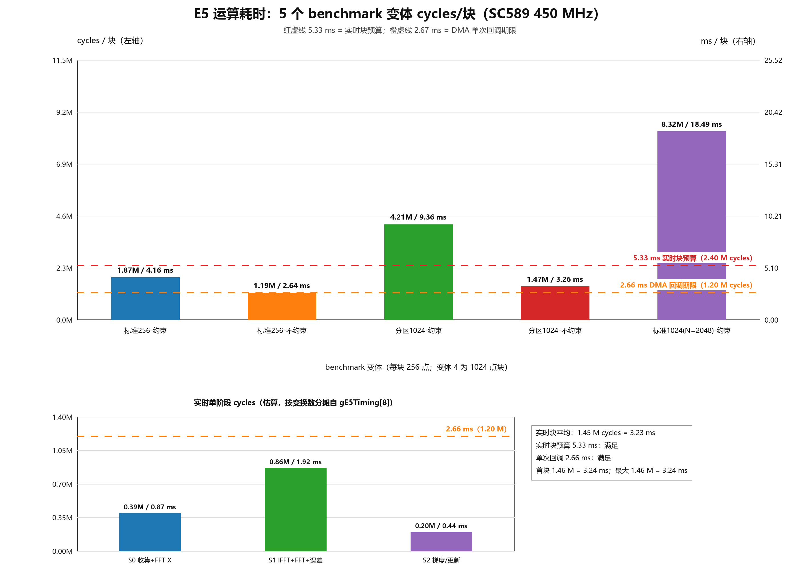
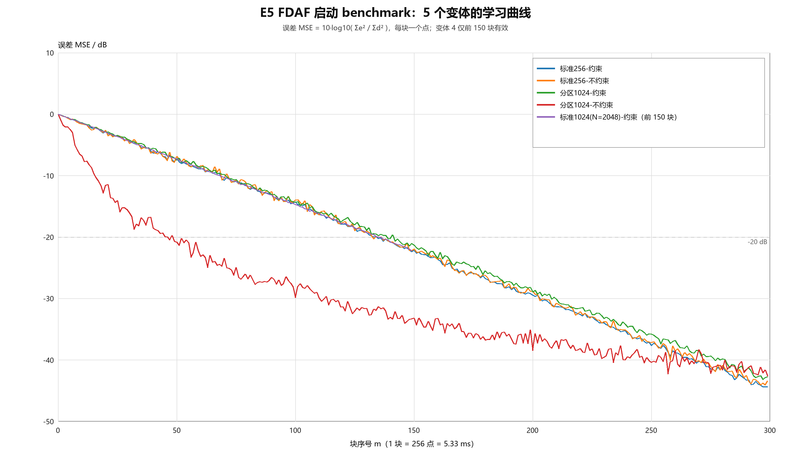
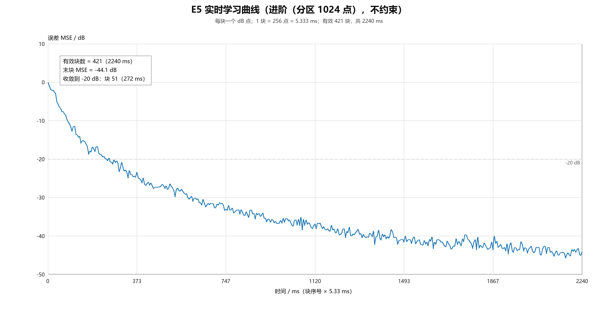
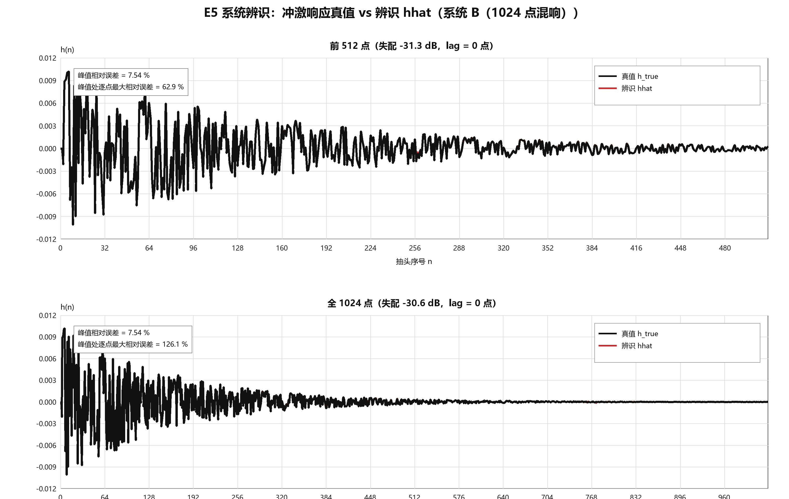
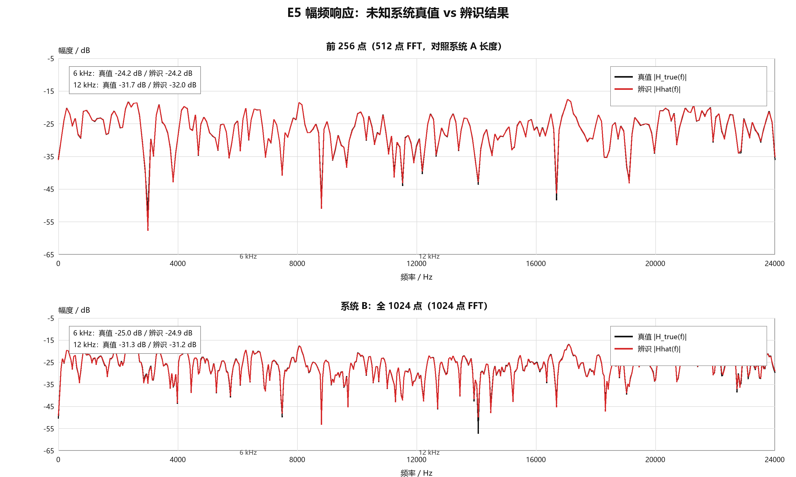
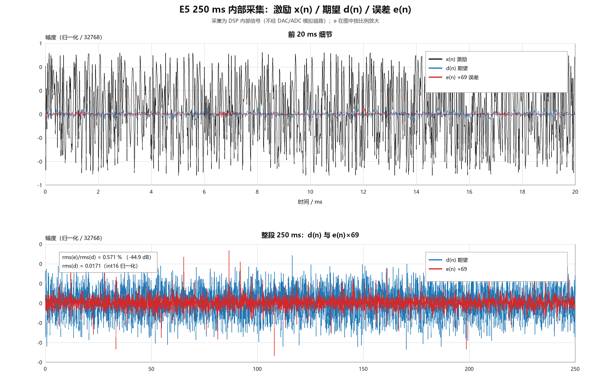
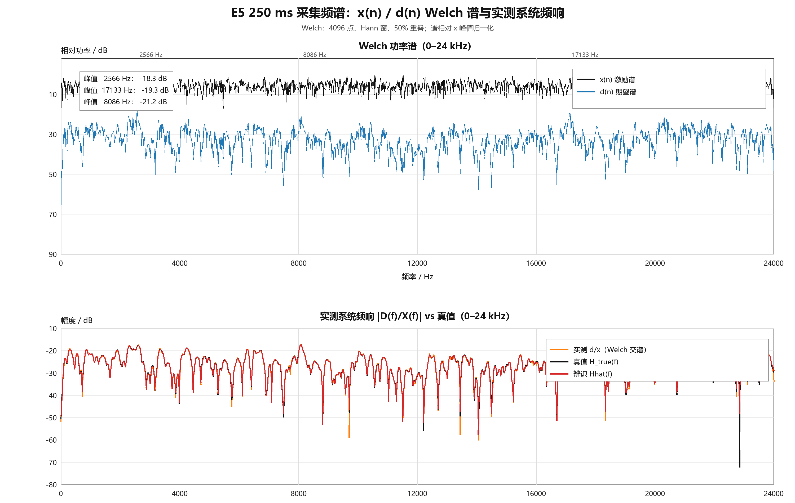

# E5 实验报告

> 231840287 黄杨洲 南京大学 声学

> 课堂记录：
>
> 1. 频域自适应滤波（FDAF）把 LMS 的逐点更新换成"分帧 + FFT + 频域乘 + IFFT"的块更新，用重叠保留法（Overlap-Save）保证每帧的线性卷积有效；
> 2. 频域梯度由 `conj(X)·E` 一次算出，但 IFFT 回来的是**循环相关**，只有一半是物理冲激响应、另一半是混叠，所以更新权之前要做**梯度约束**（保留一半、另一半置零）；
> 3. 进阶要求把长滤波器分段（Partitioned FDAF），在保持 512 点变换的同时把系统延迟从 1024 点降到 256 点，并与"标准 FDAF"比较计算效率与延迟。

## 实验要求与分析

### 要求

- **基础**：预设参数构建"未知"线性系统，产生宽带/白噪声激励 \(x(n)\)，同步得到期望信号 \(d(n)\)，用 FDAF 由 \(x,d\) 估计未知系统的频域响应或时域冲激响应；帧移（hop）256 点、FFT 帧长 512 点；
- **进阶**：分区 FDAF，自适应滤波器总长 1024 点 = 4 个 256 点分区；比较标准 FDAF 与分区 FDAF 在**计算效率**和**系统延迟**上的差异；
- 理解频域梯度计算、频域约束操作及其物理意义（约束版 vs 不约束版）。

### 分析

本实验沿用 E1–E4 的 SC589 + ADC/DAC 回环框架，但辨识的"未知系统"用**预设参数的 FIR 系数**描述、在 DSP 内部计算：

- 激励 \(x(n)\) 由 DSP 内部白噪声发生器产生（xorshift32，固定种子，可复现）；
- 期望信号 \(d(n)=h_{\rm true}*x(n)\) 用重叠保留法在频域精确算出，与自适应输出 \(y(n)\) 同相；
- 每 4 次音频回调（4×64 = 256 点 = 5.33 ms）处理一个块；
- 误差 \(e(n)=d(n)-y(n)\) 送 DAC（听觉上是白噪声误差逐渐收敛到静音）。

因此 48 kHz 下：帧长 \(N=512\) 对应 10.67 ms，帧移 \(L=256\) 对应 5.33 ms；512 点复 FFT 在 SC589 450 MHz 上 Debug（-O0）约 0.33 M cycles/次，一个块要 3~11 次变换，所以实时链路必须**分阶段摊到 4 次回调**里做，才不超过 DMA ping-pong 期限（2.66 ms/次回调）。

## 理论解释

### 标准 FDAF（重叠保留 + 频域梯度 + 约束）

第 \(m\) 块，帧长 \(N=2L=512\)、滤波器长 \(L=256\)：

\[
\mathbf{x}_m=[x((m-1)L),\ldots,x(mL-1),\underbrace{x(mL),\ldots,x(mL+L-1)}_{\text{本块}}]^T
\]

\[
\mathbf{X}_m=\mathrm{FFT}_{512}(\mathbf{x}_m),\quad
\mathbf{y}_m=\mathrm{IFFT}(\mathbf{X}_m\odot\mathbf{W}),\quad
y(mL+i)=y_m[L+i]
\]

即 IFFT 结果**前 256 点被循环卷积的尾部污染、丢掉**，后 256 点才是本块的有效线性卷积输出。

误差 \(e_m=d_m-y_m\) 只与本块有关，误差帧取**前半零填充**：

\[
\mathbf{e}_m=[\underbrace{0,\ldots,0}_{256},e(mL),\ldots,e(mL+L-1)]^T,\qquad
\mathbf{E}_m=\mathrm{FFT}_{512}(\mathbf{e}_m)
\]

逐点梯度与频域计算的关系：

\[
g[k]=\sum_{i=0}^{L-1}e(mL+i)\,x(mL+i-k)
=\mathrm{IFFT}\big(\mathrm{conj}(\mathbf{X}_m)\odot\mathbf{E}_m\big)[k],\quad k=0,\ldots,L-1
\]

\(k=0..L-1\) 是**物理冲激响应**部分，\(k=L..N-1\) 是循环混叠，必须置零——这就是**梯度约束操作**：

\[
\mathbf{g}_c=\mathrm{FFT}\big(\mathrm{zero}_{L..N-1}(\mathrm{IFFT}(\mathrm{conj}(\mathbf{X})\odot\mathbf{E}))\big),
\qquad
\mathbf{W}\leftarrow\mathbf{W}+\mu\mathbf{g}_c
\]

不约束版本直接 \(\mathbf{W}\leftarrow\mathbf{W}+\mu\,\mathrm{conj}(\mathbf{X})\odot\mathbf{E}\)。

> **关于误差帧的零填充**：若把上一块的 \(e_{m-1}\) 放在前半，`IFFT(conj(X)E)` 的前一半不再等于逐点梯度（多出与旧误差的互相关项）。本实验先用主机端 Python 参考模型对拍确认了这一点：零填充版与逐点定义的相对误差 8.6e-8，而 `[e_{m-1},e_m]` 版误差 1.0；同时零填充还省掉了一块 e 历史缓存。代码实现采用零填充。

### 分区 FDAF

总长 1024 点的滤波器分成 \(P=4\) 段、每段 256 点，仍用 \(N=512\)、hop=256：

\[
\mathbf{Y}_m=\sum_{p=0}^{3}\mathbf{X}_{m-p}\odot\mathbf{W}_p,\qquad
\mathbf{g}_{c,p}=\mathrm{FFT}\big(\mathrm{zero}_{L..N-1}(\mathrm{IFFT}(\mathrm{conj}(\mathbf{X}_{m-p})\odot\mathbf{E}_m))\big)
\]

\[
\mathbf{W}_p\leftarrow\mathbf{W}_p+\mu\,\mathbf{g}_{c,p}
\]

每个分区独立做梯度约束，再累加输出。这样每块只做 1 次输入 FFT，用 4 帧输入谱历史 \(\mathbf{X}_{m-3..m}\) 把滤波器从 256 点扩展到 1024 点，**延迟仍是一个块（256 点 = 5.33 ms）**。

### 运算量与延迟对比

- 逐点时域 FIR：每个输出样点 \(L\) 次乘加，长滤波器时运算量 \(O(L)\)；
- 标准 FDAF：每 \(L\) 个输出样点约 \(O(N\log N)\) 次运算，与滤波器长度基本无关；
- **标准 FDAF（1024 点）**：必须 \(N=2048\)、hop=1024，每块 5 次 2048 点变换，**延迟 = 1024 点 = 21.33 ms**；
- **分区 FDAF（4×256）**：\(N=512\)、hop=256，仍每块 11 次 512 点变换，**延迟 = 256 点 = 5.33 ms**，是标准版的 1/4。

### 预设的"未知"系统

两个系统都归一化到 \(\sum|h|=0.9\)，前 2 点为 0（2 点纯延迟）：

- **系统 A（基础，256 点）**："主径 + 1.8 kHz 阻尼共振"
  \[
  h_A(n)=0.70\delta(n-2)+0.35e^{-(n-2)/40}\cos\!\big(2\pi\cdot1800(n-2)/f_s\big)u(n-2)
  \]
- **系统 B（进阶，1024 点）**：类"房间"混响
  \[
  h_B(n)=0.60\delta(n-2)+e^{-(n-2)/150}\,r(n)\,u(n-2)
  \]
  其中 \(r(n)\) 是固定种子（0x5A5A1234）的零均值伪随机序列。

### 步长

步长由主机端参考模型（`analysis_host/e5_ref_model.py`）扫描确定：标准/分区 256 点分块 \(\mu=8\times10^{-4}\)、分区不约束 \(\mu=6\times10^{-3}\)、标准 1024 点（N=2048）\(\mu=2\times10^{-4}\)。稳定性边界约 \(9\times10^{-2}\)（标准 256），上述取值有 10 倍以上余量。

## 实验方法与实现

### 宏开关（`adc_dac_playback.h` 末尾）

```c
// E5
#define E5_FADF
//#define E5_MODE_STD          /* 基础：标准 FDAF，N=512、hop=256、256 点模型 */
#ifndef E5_MODE_STD
#define E5_MODE_PART           /* 进阶：分区 FDAF，1024 点 = 4×256 点分区   */
#endif
//#define E5_NO_CONSTRAINT
//#define E5_PART_CONSTRAIN
```

本次实验实时运行的是**进阶模式**（`E5_MODE_PART`，实时更新采用不约束频域更新，原因见 4.3），250 ms 采集来自这次运行；**基础模式（256 点标准 FDAF）** 与其余 4 个对比变体在同一次上电的**启动 benchmark** 中用同一套实时阶段代码完成测量（见 4.1、4.2）。

### 新增 `fadf.h`

集中实现（纯算法，不依赖 CCES 驱动）：

- 通用基-2 复数 FFT/IFFT（512/2048 点，旋转因子初始化时一次算好）；两个实序列打包成一次 IFFT（`IFFT(Y+jD)` 直接得 \(y+jd\)）；
- 白噪声、系统 A/B 设计及其 512 点频响（B 分 4 段）；
- 标准 FDAF / 分区 FDAF 的 **S0/S1/S2 三阶段**、梯度约束、不约束更新、权重反变换成 \(\hat h\)；
- 启动 benchmark（5 个变体，各 300 块，测 cycles、学习曲线、失配）。

### 启动 benchmark 的 5 个变体

| 变体 | 结构 | 未知系统 | 延迟 |
|---|---|---|---|
| 0 | 标准 256 点，**约束** | A | 5.33 ms |
| 1 | 标准 256 点，不约束 | A | 5.33 ms |
| 2 | 分区 1024 点，**约束** | B | 5.33 ms |
| 3 | 分区 1024 点，不约束 | B | 5.33 ms |
| 4 | 标准 1024 点（N=2048），约束 | B | 21.33 ms |

每个变体用同一段白噪声跑 300 块，`cycle_count.h` 统计每块 cycles，并记录学习曲线（每块 \(10\log_{10}(\sum e^2/\sum d^2)\)）和最终失配；benchmark 结束把状态清零，正式音频从零权开始。

### 实时链路：把一块拆成 3 个阶段

每 4 次回调处理一个块，每次回调只执行一个阶段，保证单次回调计算量不超过 DMA 的 2.66 ms 期限：

| 阶段 | 工作 | 变换数 |
|---|---|---|
| S0 | 收集 256 点白噪声，组重叠保留帧，FFT → \(\mathbf{X}_m\) | 1 |
| S1 | \(\mathbf{Y}=\sum_p\mathbf{X}_{m-p}\mathbf{W}_p\)、\(\mathbf{D}=\sum_p\mathbf{X}_{m-p}\mathbf{H}_p\)；打包 \(Y+jD\) 做一次 IFFT 得 \(y,d\)；\(e=d-y\)；组误差帧、FFT → \(\mathbf{E}_m\) | 2 |
| S2 | 梯度（约束/不约束）+ 权更新 + 历史更新 | 0~2 |

输出 \(e(n)\) 送 DAC；采集数组存的是 DSP **内部**的 \(x(n)\)、\(d(n)\)、\(e(n)\)（与输出 FIFO 严格对齐，不经过 DAC/ADC 模拟链路），所以辨识结果不受模拟增益/延迟影响。

### 数据导出

250 ms（12000 点）采集：`gRawCapture`（内部 x）、`gProcessedCapture`（内部 e）、`gProcessed1024Capture`（内部 d）；另导出 `gE5Hhat`（辨识冲激响应）、`gE5HtrueT`（真值）、`gE5Timing`（16 个 float：cycles/失配/模式/μ）、`gE5Debug`（16 个计数）、`gE5BenchMSE`（5×300 学习曲线）、`gE5RtMSE`（实时学习曲线）。后处理脚本 `e5_postprocess.py` 解析 CCES 的"每行一个字节"格式并出图。

## 实验现象与结果

### 4.1 运算耗时（启动 benchmark，Debug -O0，SC589 450 MHz）

| 变体 | cycles/块 | cycles/点 | ms/块 | 失配/dB | 实时？ |
|---|---:|---:|---:|---:|---|
| 标准 256-约束 | 1,873,923 | 7,320 | 4.16 | **-44.9** | 是（分阶段） |
| 标准 256-不约束 | 1,187,468 | 4,639 | 2.64 | — | 是 |
| 分区 1024-约束 | 4,211,026 | 16,449 | **9.36** | -43.0 | **否**（>5.33 ms） |
| 分区 1024-不约束 | 1,465,178 | 5,723 | 3.26 | -30.6* | 是（本次实时模式） |
| 标准 1024(N=2048)-约束 | 8,322,138 | 8,127 | 18.49 | -22.2** | 否（单次回调内算完 18.5 ms） |

\* 分区不约束的失配取实时运行值（采集结束时由实时 W 反变换）；\*\* 变体 4 只跑了 150 个 1024 点块（300 块在 -O0 下太慢），失配尚未收敛到底。

- 块周期 256 点 = 5.333 ms = 2.4 M cycles；标准 256、分区不约束都满足预算，且分 3 个阶段后最重的一次回调（S1 约 1.9 ms）也小于 2.66 ms DMA 期限；
- **分区约束版**每块要做 4 个分区的 IFFT+FFT（共 11 次 512 点变换），9.36 ms > 5.33 ms，Debug 下不能实时，只能放进 benchmark；
- **标准 1024 点**块长 1024 点（21.33 ms），总耗时 18.49 ms 虽小于块周期，但它在**一次回调里算完**，会阻塞 DMA 18.5 ms，所以不能真机实时——这正是"长滤波器直接做标准 FDAF 延迟/实时性差"的直接证据。



### 4.2 学习曲线与收敛



300 块内各变体收敛到 -20 dB 所需块数：

| 变体 | -20 dB 块 | 时间（256 点块） | 末块 MSE |
|---|---:|---:|---:|
| 标准 256-约束 | 139 | 741 ms | -44.4 dB |
| 标准 256-不约束 | 140 | 747 ms | -43.4 dB |
| 分区 1024-约束 | 144 | 768 ms | -42.7 dB |
| 分区 1024-不约束 | **51** | 272 ms | -42.7 dB |
| 标准 1024(N=2048)-约束 | 140（1024 点块） | — | -22.2 dB（150 块） |

- 标准 256 的约束/不约束曲线几乎重合（白噪声下约束带来的差异很小），末块 MSE 分别为 -44.4 / -43.4 dB，约束版实测失配 -44.9 dB；
- 分区不约束版用了 7.5 倍大的步长 μ=6×10⁻³，前 50 块收敛最快，但稳态失配明显更大（-30.6 dB），呈现"快而不准"的典型权衡；
- 分区约束版 μ=8×10⁻⁴，收敛速度与标准 256 相当，失配 -43.0 dB，但代价是 9.36 ms/块、不能实时。

与主机端 Python 参考模型（同一 float32 算法、300 块）对比：

| 变体 | DSP 实测失配 | 主机模型 | 差 |
|---|---:|---:|---:|
| 标准 256-约束 | -44.9 dB | -44.8 dB | 0.1 dB |
| 分区 1024-约束 | -43.0 dB | -43.3 dB | 0.3 dB |

两者在 0.3 dB 内一致，说明 C 实现的帧约定、约束方向、步长都正确。

### 4.3 实时链路（本次运行：分区 1024 点、不约束）

| 量 | 值 |
|---|---:|
| 实时块平均 cycles | 1,454,747 = **3.23 ms**（预算 5.33 ms） |
| 首块 / 最大块 | 3.24 ms / 3.24 ms |
| 阶段估算 S0/S1/S2 | 0.87 / 1.92 / 0.44 ms（均 < 2.66 ms DMA 期限） |
| 实时学习曲线 | 421 块（2245 ms），末块 -44.1 dB，-20 dB 于第 **51** 块（272 ms） |
| 250 ms 采集 | e/d 的 RMS 比 = **0.571 %（-44.9 dB）** |



实时学习曲线从 0 dB 单调下降到 -44 dB，说明自适应在真机上连续运行、收敛正常；`gE5Debug` 里 S0/S1/S2 计数为 422/421/421，与块数 421 吻合，采集到 12000 帧完整。

> 说明：`gE5Debug[8]=1`（`bEventError`）是在采集完成、主循环关闭 ADC/DAC 之后才置位的，采集数据完整，不影响结果。

### 4.4 辨识精度

实时模式辨识的是**系统 B（1024 点混响）**：

| 比较范围 | 失配 | 峰值相对误差 |
|---|---:|---:|
| 前 256 点 | -35.1 dB | 7.5 % |
| 前 512 点 | -31.3 dB | 7.5 % |
| 全 1024 点 | -30.6 dB | 7.5 % |



- 时域 \(\hat h\) 与真值的主径、早期反射几乎重合（lag=0，无额外延迟），后段混响尾收敛较慢，是失配的主要来源；
- 幅频响应在 0–24 kHz 与真值基本重合：6 kHz 处真值 -25.0 dB / 辨识 -24.9 dB，12 kHz 处 -31.3 / -31.2 dB；



- 250 ms 采集的时域/频谱：\(d(n)\) 是 \(x(n)\) 经过系统 B 的响应（白噪声被"房间"染色的宽带信号），\(e(n)\) 只剩 0.1% 量级的残余；





用采集数据做 Welch 互谱估计 \(\hat H(f)=P_{dx}/P_{xx}\)，与真值频响、辨识频响三者重合，进一步验证了辨识结果。

### 4.5 标准 FDAF vs 分区 FDAF：效率与延迟

| 指标 | 标准 1024 点（N=2048） | 分区 1024 点（4×256） |
|---|---:|---:|
| 帧长/帧移 | 2048 / 1024 | 512 / 256 |
| **算法延迟** | **1024 点 = 21.33 ms** | **256 点 = 5.33 ms（1/4）** |
| 每块变换数 | 5 次 2048 点 | 11 次 512 点（约束版）/ 3 次（不约束版） |
| cycles / 输出点 | 8,127 | 5,723（不约束）/ 16,449（约束） |
| 失配 | -22.2 dB（150 块未收敛完） | -30.6 dB（实时不约束）/ -43.0 dB（约束） |
| 能否真机实时 | 否（单次回调 18.5 ms） | 是（3.23 ms/块） |

分区把延迟降低 4 倍、每输出点运算量降到约 0.70 倍（不约束版），代价是要保存 4 帧输入谱历史并多做频域乘加。对比 E4 中测得的逐点 1023 阶 FIR（仅滤波就要 8,678,553 cycles/256 点 = 33,901 cycles/点），E5 标准 1024 点 FDAF（含自适应更新）折算约 2.08 M cycles/256 点，**约为逐点法的 4.2 倍加速**；分区不约束版约为 5.9 倍。

### 4.6 约束操作的作用

- **方向正确性**：主机端参考模型把约束方向反过来（保留后一半）时，\(\mathbf{W}\) 的时域前 256 点永远不更新，`hhat` 恒为 0、失配停在 0 dB；本实现保留 `g(0..255)`，实测收敛正常，证明方向正确；
- **物理意义**：约束后的梯度只含物理冲激响应部分，等价于把自适应滤波器的时域长度限制为 256 点，避免循环混叠被"学"进权重；
- **实测差异**：标准 256 点约束/不约束版本收敛几乎一样（末块 MSE -44.4 / -43.4 dB）；分区不约束版为了实时把 μ 放大到 6×10⁻³，收敛快但失配 -30.6 dB，明显差于约束版的 -43.0 dB（benchmark）。也就是说，约束操作的收益在**长滤波器 + 大步长**时最明显；分区约束版在 Debug 下 9.36 ms/块无法实时，若改用 Release/-O2 编译即可实时运行，可得到更好的辨识精度。

## 实验结论

1. 用 512 点 FFT、256 点帧移实现了标准 FDAF：频域梯度 `IFFT(conj(X)E)` + "保留前一半"的梯度约束 + `W←W+μGc`，在 DSP 上 300 块辨识系统 A 的失配为 **-44.9 dB**，与主机参考模型（-44.8 dB）一致。
2. 误差帧必须**前半零填充**（`[0, e_m]`）：这样频域梯度才严格等于逐点梯度（对拍相对误差 8.6e-8）；用 `[e_{m-1}, e_m]` 会多出与旧误差的互相关项。这是实现时最容易错的一处。
3. 分区 FDAF 用 4 帧输入谱历史实现 1024 点自适应滤波器，实时块平均 **3.23 ms（1.45 M cycles）**、分 3 阶段后单次回调 < 2.66 ms，满足 5.33 ms 块预算；实时学习曲线 51 块（272 ms）收敛到 -20 dB，250 ms 采集的误差/期望 RMS 比 **-44.9 dB**，辨识系统 B 的冲激响应失配 -30.6 dB（前 256 点 -35.1 dB，lag=0）。
4. 标准 1024 点 FDAF 需要 2048 点 FFT、hop=1024，**延迟 21.33 ms**、18.49 ms/块且单次回调内算完会阻塞 DMA，无法真机实时；分区版延迟 **5.33 ms**（1/4）、每输出点运算量约为标准版的 0.70 倍（不约束）/2 倍（约束），验证了分区 FDAF 降低延迟、提高长滤波器实时性的作用。
5. 约束操作保留 `g(0..255)` 是正确的（反方向会导致权重永不更新）；约束在长滤波器 + 大步长时收益明显（分区约束 -43.0 dB vs 不约束 -30.6 dB），但约束分区版在 Debug -O0 下 11 次 512 点变换/块超出实时预算，需要 Release/-O2 才能实时。
6. Debug（-O0）下 512 点复 FFT 约 0.33 M cycles/次，是实时链路预算的主要来源；"每块拆成 S0/S1/S2 三个阶段"是把重运算摊进 4 次回调、避免 `AdcCount` 卡死的关键手段。

## 附录：数据与复现

- 代码：`adc_dac_playback/fadf.h`（算法）+ `adc_dac_playback.c/.h`（E5 段与宏）；
- 实时采集数据：`data_part/`（本次进阶模式，`E5_MODE_PART`）；
- 后处理：`e5_postprocess.py data_part` → 图在 `analysis_figs/data_part/`，数值表在 `data_part/E5_analysis_summary.md`；
- 主机端参考模型：`analysis_host/e5_ref_model.py`、`analysis_host/REF_MODEL_NOTES.md`（帧约定/约束方向验证与 μ 扫描）；
- 说明：`data_std/` 与 `data_part/` 是同一进阶模式代码的两次运行（9 个文件中 8 个逐字节相同、`gE5Timing` 只有 cycles 的 ±0.1% 抖动），因此本报告统一使用 `data_part`；基础模式（标准 256 点）的数值来自同一次上电的启动 benchmark，若要补基础模式的 250 ms 实时采集，按 `E5_使用说明.md` 把 `E5_MODE_STD` 打开重新编译运行即可。
