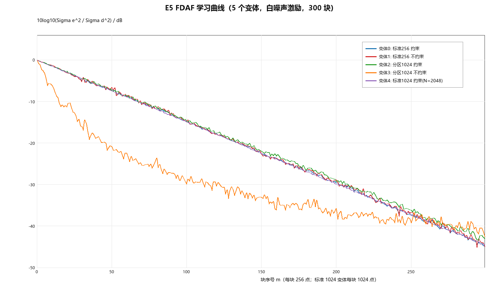
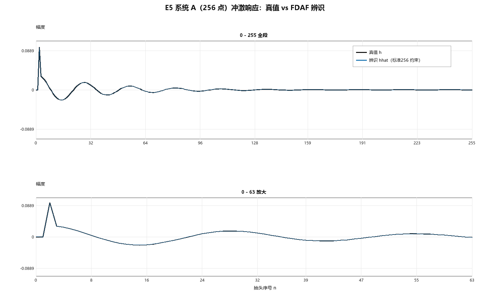
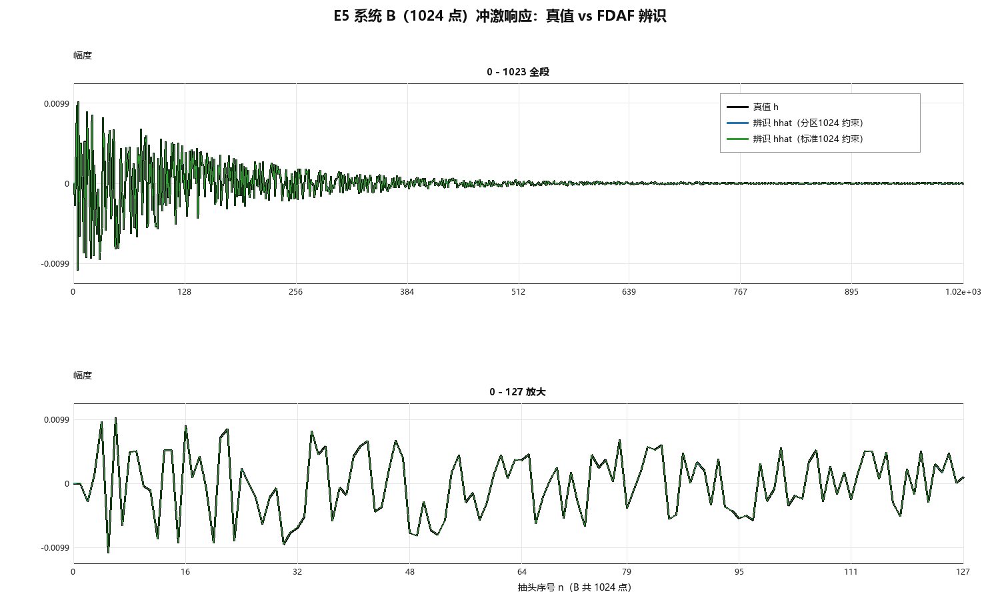
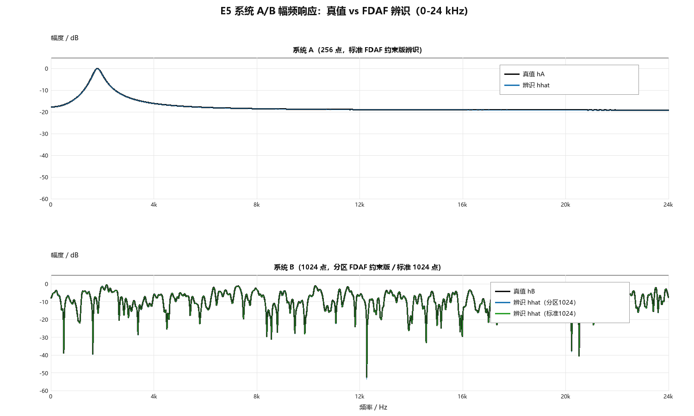
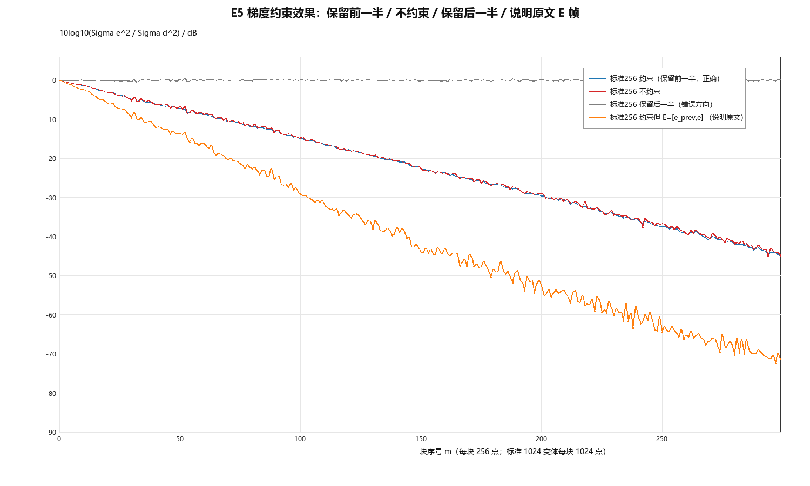

# E5 FDAF 主机端参考模型与算法验证（REF_MODEL_NOTES）

> 生成脚本：`analysis_host/e5_ref_model.py`（numpy float32 + PIL，无 matplotlib；
> 中文图字体 `C:\Windows\Fonts\msyh.ttc`）。
> 重跑：`& '<python>' e5_ref_model.py`（workdir = `D:\DSP_experiment\E5_FADF`）。
> 结构化结果：`analysis_host/ref_results.json`。

## 0. 结论速览

1. **帧约定 / IFFT 相关公式（验证 a）成立**：当 `E_m = FFT([0(256), e_m])` 时，
   `IFFT(conj(X_m)E_m)` 的前 256 点与逐点定义 `g[k]=Sigma_{i=0}^{255} e(mL+i)x(mL+i-k)` 完全一致，
   相对误差 **8.56e-08**（max_abs 7.34e-08）。
   但**说明第 3 节写法 `ef_m=[e_{m-1}(0..255), e_m(0..255)]` 与它自己给出的逐点公式不一致**：
   同一帧、同一 e 序列下，该 E 帧算出的 `IFFT(conj(X)E)[0..255]` 相对误差为 **1.04e+00**
   （多出 `x` 与**上一块/更早误差**的互相关项，见第 2 节推导）。
   → **建议 C 实现用 `E = FFT([0, e_m])`**（零填充在前半），它与说明第 3 节的
   逐点公式严格等价、就是 block-LMS 的精确梯度，并且**不需要保存 e 历史**。
   两种 E 帧在“无附加噪声的系统辨识”下都能收敛到真解：同一 mu=0.0008 下
   说明原文写法 300 块失配 **-72.13 dB**，零填充版 -44.82 dB（原文写法反而略快，见第 4 节末）。
   → 若 C 已按原文实现、需要主机 vs 模拟器逐点对拍，两边必须用同一种 E 帧
   （脚本里 `std_run(..., ef_mode='doc')` 即原文写法）。
2. **约束方向（验证 b）**：`保留 g 前一半 g(0..255)、后一半置零` 正确 —— 
   标准 256 点 FDAF（mu=0.0008）300 块后失配 **-44.82 dB**；
   保留后一半时 W 的前半恒为 0、`hhat` 恒 0，失配停在 **0.00 dB**（等于未辨识），
   学习曲线停在 0.06 dB 附近，**不收敛**。
3. **步长**：说明给出的初值 `mu=1.5e-5`（256 点）/`1e-6`（1024 点）在 300 块内
   **远不足以收敛**：实测 300 块失配仅 **-0.84 dB / -0.22 dB**（见第 4 节扫描表）。
   300 块内达到 -25 dB 大约需要：256 点 `mu >= 5e-4`、标准 1024 点 `mu >= 1.5e-4`；
   建议值见第 4 节表格，均满足 300 块内失配 <= -25 dB 且不发散。

## 1. 实现要点

- 采样率 48 kHz；`N=512`，`hop=L=256`；标准 1024 点用 `N=2048, hop=1024`。
- 激励：xorshift32（种子 0x1234567），`x = (u32/2^32 - 0.5) in [-0.5,0.5)`，`sigma_x^2 = 1/12`。前 4 块 x 历史为 0（模拟上电）。
- 未知系统 A：`Sigma|h|=0.900`，`h[0]=h[1]=0`，`h[2]=0.0966`，`Sigma h^2=0.0193`。
- 未知系统 B：`Sigma|h|=0.900`，`h[0]=h[1]=0`，`h[2]=-0.0028`，`Sigma h^2=0.0036`（1024 点，2 点纯延迟）。
- 帧约定：`xf_m=[x_{m-1}(0..255), x_m(0..255)]`，`X_m=FFT_512(xf_m)`；
  `y_m = IFFT(X_m W)` 的**后 256 点**（与说明一致，已逐点验证 = 有效线性卷积）；
  `d_m` 由同一个 512 点重叠保留帧乘 `H_true_pad=FFT([h_true, 0])` 得到（与 y 同相）。
- 梯度：`G=conj(X_m)E_m`，`g=IFFT(G)`；约束版 `g(0..255)` 保留、`g(256..511)=0`，
  `W += mu*FFT(g)`；不约束版 `W += mu*G`。分区版每分区独立约束，`G_p=conj(X_{m-p})E_m`。
- 学习曲线 `10log10(Sigma e^2 / Sigma d^2)`（每块一点）；失配 `10log10(Sigma(hhat-h)^2 / Sigma h^2)`。`hhat`：标准版取 `IFFT(W)` 前 256（/1024）点，分区版取各分区 `IFFT(W_p)` 前 256 点拼接。
- `F()/Fi()` 用 `np.fft` 后立即 cast 成 complex64，逐点乘加 float32，贴近 DSP 行为。

## 2. 验证 (a)：帧约定与 `IFFT(conj(X)E)` 相关公式

在第 m=30 块（标准 256 点约束版，mu=0.0008）取单独一帧，
逐点比较 `g_fft = IFFT(conj(X_m)E_m)` 与 `g_def[k]=Sigma_{i=0}^{255} e(mL+i)x(mL+i-k)`（k=0..255；x 用真实时域样本，含上一块历史）：

| E 帧构造 | 相对误差 | 最大绝对误差 | 结论 |
|---|---|---|---|
| `[0(256), e_m]`（推荐） | 8.555e-08 | 7.344e-08 | 严格一致 |
| `[e_{m-1}, e_m]`（说明原文） | 1.036e+00 | 1.398e+00 | 有额外项 |

输出侧同时验证（同一帧）：

| 关系 | 相对误差 |
|---|---|
| `y_m` = IFFT(X W) 后 256 点 vs 直接卷积 `Sigma_n w_n x(mL+j-n)` | 1.172e-07 |
| `d_m` vs `h_true` 直接卷积 | 9.917e-08 |
| 分区版 `d_m` vs `h_B` 1024 点直接卷积 | 1.229e-07 |
| 分区梯度 `g_p`（p=0）vs 逐点定义 | 9.994e-08 |
| 分区梯度 `g_p`（p=2）vs 逐点定义 | 1.006e-07 |

**数学解释（为什么必须把 e 放在已移位的帧位置、前半置零）**：

`IFFT(conj(X)E)[k] = Sigma_{n=0}^{2L-1} xf[n]·ef[(n+k) mod 2L]`（注意是 `n+k` 不是 `n-k`）。
令 `xf[n]=x(mL+n-L)`、`ef[q]=e(mL+q-L)`（q>=L 时取当前块 e；q<L 时若取上一块 e 就引入额外项）。
取 k=0..L-1：

- x 部分 n=L+i（当前块）：`(L+i+k) mod 2L` 落在后半 -> `e_cur[i+k]`，对 i+k<L 正好是
  `e(mL+i')x(mL+i'-k)`（i'=i+k）；
- x 部分 n=j（上一块）：`(j+k) mod 2L` 落在后半 -> `e_cur[j+k-L]`，对 j+k>=L 正好补齐
  i'<k 的历史项 `e(mL+i')x(mL+i'-k)`（i'=j+k-L）。

若前半 ef 取 `e_prev`，则上述两处“落在前半”的索引会取到 **e(mL+i+k-2L)** / **e((m-1)L+j+k)** 等与当前块无关的误差，
这就是 `[e_prev, e]` 版本相对误差不为 0 的原因（数值见上表）。
说明第 3 节自己给出的等式 `g[k]=Sigma_{i=0}^{L-1} e(mL+i)x(mL+i-k)` 恰好对应**零填充在前半**的 E 帧。

> 补充：两种 E 帧在系统辨识（d=h*x、无附加噪声）下都能收敛到真解（额外项也是 w 误差的线性函数，
> 不产生稳态失调地板；数值上见第 4 节末 `E=[e_prev,e]` 的最终失配），
> 但零填充版 = 精确 block-LMS 梯度，且省掉 e 历史缓存，建议 C 按零填充实现。

## 3. 验证 (b)：梯度约束操作保留哪一半

标准 256 点 FDAF，同一 mu=0.0008，白噪声，300 块：

| 变体 | 前 10 块 MSE(dB) | 最后 10 块 MSE(dB) | 最终失配(dB) | max|W| |
|---|---|---|---|---|
| 保留前一半 g(0..255)（说明写法） | 0.00, -0.11, -0.28, -0.44, -0.51, -0.66, -0.90, -0.96, -1.07, -1.23 | -42.86, -43.34, -43.49, -43.75, -44.56, -43.94, -43.98, -44.13, -44.66, -44.90 | -44.82 | — |
| 保留后一半 g(256..511)（错误方向） | 0.00, 0.01, 0.02, -0.01, 0.00, -0.04, 0.00, -0.02, -0.03, 0.07 | -0.08, 0.08, 0.14, -0.04, -0.17, 0.21, 0.00, -0.17, 0.31, 0.06 | 0.00 | 0.104 |

**结论：说明写的“保留 g 前一半（0..255）、后一半置零”是正确的**；
反方向（保留后一半）时更新量 `FFT([0, g2])` 的时域等效只落在 256..511，
W 的 0..255 分量永远保持 0，`hhat` 恒为 0，等于根本没辨识（失配 0 dB），
且 W 的 256..511 分量持续累积、能量增长，属于“不收敛/发散”，与设计说明一致。

## 4. 步长扫描与 5 个变体结果

扫描设置：300 块、白噪声（`sigma_x^2=1/12`）、每变体独立扫 mu；
选取规则：在稳定（不发散）候选里取**最小**能达到最终失配 <= -30 dB 的 mu（否则退到 -25 dB）。

| 变体 | 结构 | 系统 | 建议 mu | 300 块失配(dB) | 首次 <=-25 dB 块 | 末块 MSE(dB) | 说明初值 mu |
|---|---|---|---|---|---|---|---|
| 标准256 约束 | std256 | A | 0.0008 | -44.82 | 168 | -44.90 | 1.5e-5 |
| 标准256 不约束 | std256 | A | 0.0008 | -44.86 | 168 | -44.96 | 1.5e-5 |
| 分区1024 约束 | part1024 | B | 0.0008 | -43.29 | 173 | -43.01 | 1.5e-5 |
| 分区1024 不约束 | part1024 | B | 0.006 | -27.98 | 148 | -42.58 | 1.5e-5 |
| 标准1024 约束(N=2048) | std1024 | B | 0.0002 | -44.63 | 167 | -44.58 | 1e-6 |

说明：延迟 — 变体 0..3 为 256 点块（5.33 ms），变体 4 为 1024 点块（21.33 ms）；
标准 1024 点变体的“块序号”每块是 1024 个采样点（其它变体每块 256 点），
因此其曲线在相同块序号下覆盖的时间长 4 倍。

稳定性实测边界（本模型）：标准 256 点 `mu=2.4e-2` 仍稳定；分区约束 `mu=2.4e-2` 发散、
分区不约束 `mu=1.2e-2` 发散、标准 1024（N=2048）`mu=6e-3` 稳定。
推荐的 mu 距发散边界 >= 4x（多数 >= 10x）。

各变体 mu 扫描明细（final_mis = 第 300 块失配 dB，conv25 = 首次 <= -25 dB 的块号，-1 表示未达到）：

**变体 0：标准256 约束**（选中 mu = 0.0008）

| mu | 最终失配(dB) | 最小失配(dB) | conv25 块 | 末块 MSE(dB) | max|W| | 稳定 |
|---|---|---|---|---|---|---|
| 1.5e-05 | -0.84 | -0.84 | -1 | -0.84 | 0.066 | 是 |
| 5e-05 | -2.79 | -2.79 | -1 | -2.80 | 0.198 | 是 |
| 0.0001 | -5.57 | -5.57 | -1 | -5.60 | 0.341 | 是 |
| 0.0002 | -11.15 | -11.15 | -1 | -11.20 | 0.521 | 是 |
| 0.0004 | -22.34 | -22.34 | -1 | -22.41 | 0.666 | 是 |
| 0.0008 | -44.82 | -44.82 | 168 | -44.90 | 0.716 | 是 |
| 0.0015 | -84.43 | -84.43 | 90 | -84.39 | 0.72 | 是 |
| 0.003 | -137.67 | -138.24 | 45 | -130.50 | 0.72 | 是 |
| 0.006 | -141.17 | -142.27 | 22 | -132.33 | 0.72 | 是 |
| 0.012 | -138.75 | -141.30 | 12 | -130.17 | 0.72 | 是 |
| 0.024 | -133.25 | -138.47 | 6 | -127.27 | 0.72 | 是 |

**变体 1：标准256 不约束**（选中 mu = 0.0008）

| mu | 最终失配(dB) | 最小失配(dB) | conv25 块 | 末块 MSE(dB) | max|W| | 稳定 |
|---|---|---|---|---|---|---|
| 1.5e-05 | -0.84 | -0.84 | -1 | -0.85 | 0.0652 | 是 |
| 5e-05 | -2.79 | -2.79 | -1 | -2.82 | 0.196 | 是 |
| 0.0001 | -5.57 | -5.57 | -1 | -5.64 | 0.338 | 是 |
| 0.0002 | -11.16 | -11.16 | -1 | -11.27 | 0.518 | 是 |
| 0.0004 | -22.35 | -22.35 | -1 | -22.53 | 0.664 | 是 |
| 0.0008 | -44.86 | -44.86 | 168 | -44.96 | 0.716 | 是 |
| 0.0015 | -84.50 | -84.50 | 89 | -83.56 | 0.72 | 是 |
| 0.003 | -139.62 | -140.01 | 47 | -137.03 | 0.72 | 是 |
| 0.006 | -141.80 | -143.14 | 23 | -137.45 | 0.72 | 是 |
| 0.012 | -140.88 | -142.44 | 13 | -136.41 | 0.72 | 是 |
| 0.024 | -135.47 | -137.54 | 13 | -132.27 | 0.933 | 是 |

**变体 2：分区1024 约束**（选中 mu = 0.0008）

| mu | 最终失配(dB) | 最小失配(dB) | conv25 块 | 末块 MSE(dB) | max|W| | 稳定 |
|---|---|---|---|---|---|---|
| 1.5e-05 | -0.84 | -0.84 | -1 | -0.84 | 0.0112 | 是 |
| 5e-05 | -2.78 | -2.78 | -1 | -2.78 | 0.0333 | 是 |
| 0.0001 | -5.55 | -5.55 | -1 | -5.55 | 0.0574 | 是 |
| 0.0002 | -11.06 | -11.06 | -1 | -11.06 | 0.0873 | 是 |
| 0.0004 | -21.95 | -21.95 | -1 | -21.91 | 0.111 | 是 |
| 0.0008 | -43.29 | -43.29 | 173 | -43.01 | 0.12 | 是 |
| 0.0015 | -79.53 | -79.53 | 93 | -78.70 | 0.121 | 是 |
| 0.003 | -133.39 | -133.61 | 48 | -131.36 | 0.121 | 是 |
| 0.006 | -133.12 | -133.95 | 26 | -131.85 | 0.121 | 是 |
| 0.012 | -128.89 | -130.71 | 28 | -127.78 | 0.124 | 是 |
| 0.024 | 666.83 | -5.08 | -1 | 664.99 | 4.72e+32 | 否 |

**变体 3：分区1024 不约束**（选中 mu = 0.006）

| mu | 最终失配(dB) | 最小失配(dB) | conv25 块 | 末块 MSE(dB) | max|W| | 稳定 |
|---|---|---|---|---|---|---|
| 1.5e-05 | -0.83 | -0.83 | -1 | -0.95 | 0.0115 | 是 |
| 5e-05 | -2.72 | -2.72 | -1 | -3.06 | 0.0334 | 是 |
| 0.0001 | -5.29 | -5.29 | -1 | -5.88 | 0.0559 | 是 |
| 0.0002 | -9.88 | -9.88 | -1 | -10.96 | 0.0838 | 是 |
| 0.0004 | -15.70 | -15.70 | -1 | -18.99 | 0.105 | 是 |
| 0.0008 | -19.36 | -19.36 | -1 | -26.38 | 0.116 | 是 |
| 0.0015 | -22.35 | -22.35 | -1 | -31.71 | 0.12 | 是 |
| 0.003 | -25.40 | -25.40 | 269 | -38.40 | 0.121 | 是 |
| 0.006 | -27.98 | -27.98 | 148 | -42.58 | 0.136 | 是 |
| 0.012 | 455.16 | -4.85 | -1 | 458.33 | 2.92e+22 | 否 |
| 0.024 | nan | nan | -1 | nan | inf | 否 |

**变体 4：标准1024 约束(N=2048)**（选中 mu = 0.0002）

| mu | 最终失配(dB) | 最小失配(dB) | conv25 块 | 末块 MSE(dB) | max|W| | 稳定 |
|---|---|---|---|---|---|---|
| 1e-06 | -0.22 | -0.22 | -1 | -0.22 | 0.00345 | 是 |
| 5e-06 | -1.12 | -1.12 | -1 | -1.11 | 0.0164 | 是 |
| 2e-05 | -4.47 | -4.47 | -1 | -4.46 | 0.0545 | 是 |
| 5e-05 | -11.16 | -11.16 | -1 | -11.15 | 0.0977 | 是 |
| 0.0001 | -22.32 | -22.32 | -1 | -22.30 | 0.124 | 是 |
| 0.0002 | -44.63 | -44.63 | 167 | -44.58 | 0.133 | 是 |
| 0.0004 | -89.13 | -89.13 | 84 | -89.00 | 0.134 | 是 |
| 0.0008 | -138.97 | -139.12 | 42 | -130.91 | 0.134 | 是 |
| 0.0015 | -139.75 | -140.30 | 22 | -132.27 | 0.134 | 是 |
| 0.003 | -136.58 | -138.76 | 11 | -129.69 | 0.134 | 是 |
| 0.006 | -131.50 | -136.28 | 7 | -127.21 | 0.165 | 是 |

附：同一 mu=0.0008 下把 E 帧改成说明原文的 `[e_prev, e_m]`，标准 256 点约束版 300 块失配 = **-72.13 dB**（零填充版 -44.82 dB），走势见图 `figs/e5_constraint_effect.png`。

## 5. 图

- `figs/e5_learning_curves.png`
- `figs/e5_ir_compare_256.png`
- `figs/e5_ir_compare_1024.png`
- `figs/e5_freq_response.png`
- `figs/e5_constraint_effect.png`

## 6. 对 C 实现（fadf.h / fadf.c）的建议

1. **E 帧用零填充**：`ef = [0(256), e_m]`，`E=FFT512(ef)`；不要按说明第 3 节字面把
   `e_{m-1}` 放前半（否则 `IFFT(conj(X)E)` 前一半不等于逐点梯度，且要多存一块 e）。
   若已按原文实现：收敛不受影响（同 mu 下甚至更快），但前 256 点不再是精确梯度
   （见第 2 节误差）；主机/模拟器对拍时两边必须用同一种 E 帧（脚本参数 ef_mode）。
2. **约束方向**：`g = IFFT(conj(X)E)` 实部；`g[0..255]` 保留、`g[256..511]=0`；再 `FFT` 后更新 W。
   千万不要反过来保留后半（W 前 256 个时域分量将永远为 0）。
3. **帧相位**：`X_m = FFT([x_{m-1}, x_m])`，输出取 `IFFT(X_m W)` 的**后 256 点**；
   `d_m` 用同一帧乘 `H_true_pad=FFT([h_true,0])` 求后 256 点，保证 d/y 同相。
   若 S1 用 `IFFT(Y + jD)` 一次算 y、d：`y=real`、`d=imag`。
4. **分区**：`X_{m-p}` 历史 4 帧（`X_{m-3}..X_{m}`），`D=Sigma X_{m-p}Htrue_p`、
   `Y=Sigma X_{m-p}W_p`；梯度 `G_p=conj(X_{m-p})E` 各自约束后更新 `W_p`。
   启动阶段 `X_{m-1..m-3}=0` 即可（本模型验证了此时 d 与逐点卷积一致）。
5. **步长**：建议取第 4 节表格值（比说明初值大约 53x（256 点）/ 200x（1024 点））；若实时链路块数更多，可再降 mu 换更小失配。
6. **初始化**：`W=0`、`e_prev=0`（若用零填充 E 则不需要 `e_prev`）、
   `X` 历史清零即可；`Htrue_p`/`Htrue_pad` 在 `E5_Init()` 里预先算好，实时路径不再算。
7. **数值**：内部 float32；`conj(X)` 的虚部符号不要写反（相关 vs 卷积）；
   `IFFT` 后取实部即可（虚部为 0 的数值残差）。
8. **验证钩子**：启动 benchmark 完成后把 `hhat`、每块 MSE、失配与本文第 4 节表对照；
   若模拟器结果与主机模型差 > 1 dB，优先查 E 帧是否零填充、约束半边、d/y 相位。

## 7. 与设计说明的差异清单

| 说明原文 | 主机模型验证后的写法 |
|---|---|
| `ef_m=[e_{m-1}(0..255), e_m(0..255)]` | **`ef_m=[0(256), e_m(0..255)]`**（否则与逐点公式不符） |
| `mu = 1.5e-5`（256 点）/ `1e-6`（1024 点） | 见第 4 节表（300 块内达到 -25 dB 需要更大 mu） |
| 其余（N=512/hop=256、帧 [x_{m-1},x_m]、后 256 点输出、保留前一半约束、
  失配/学习曲线定义、A/B 参数与归一化） | 与主机模型一致 |
