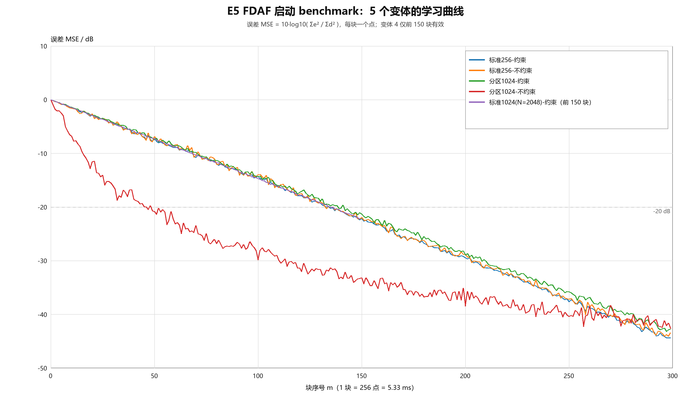
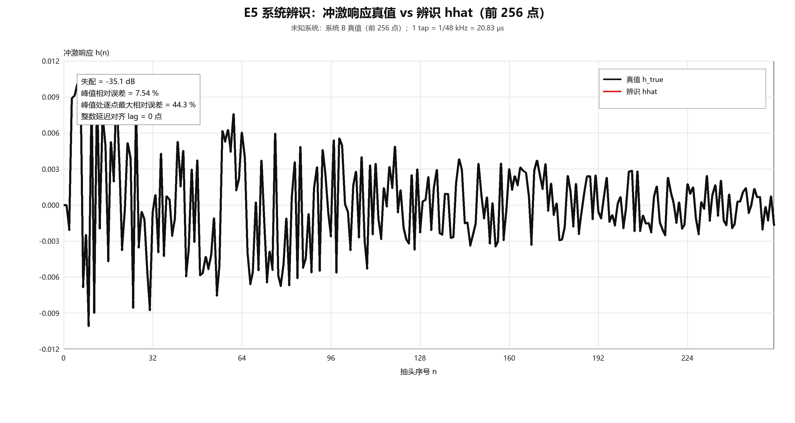
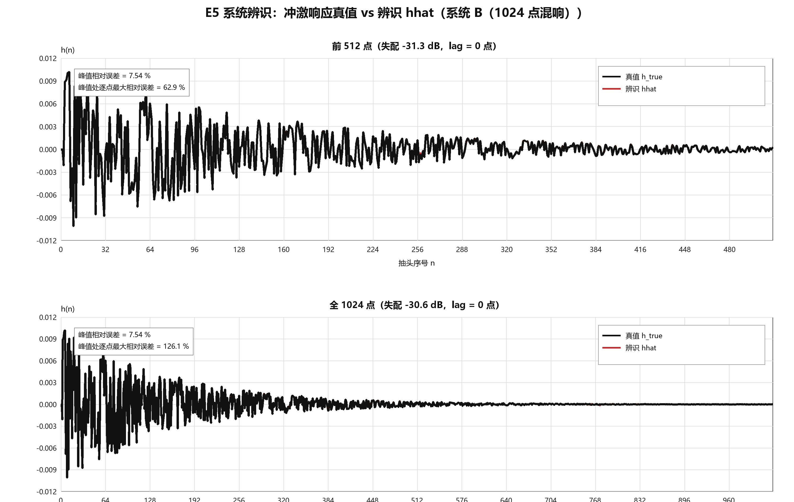
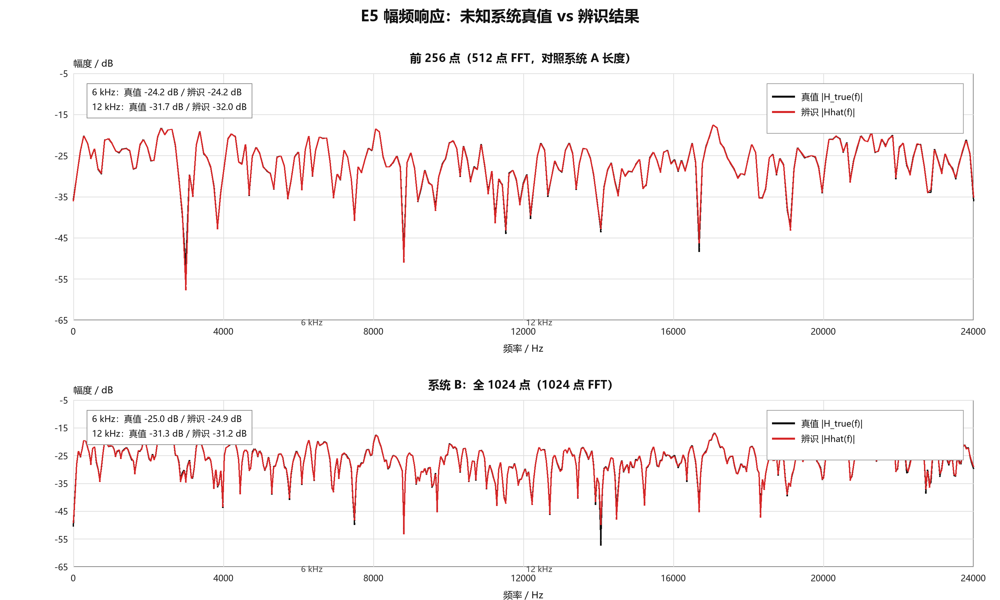
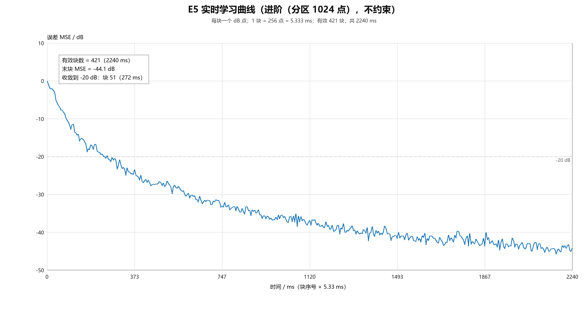
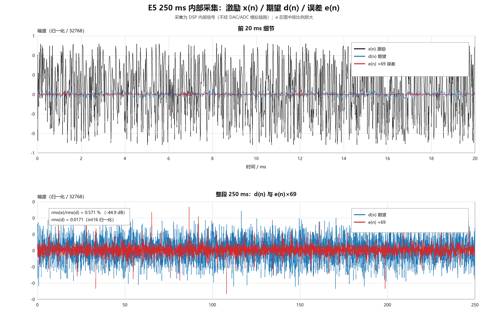
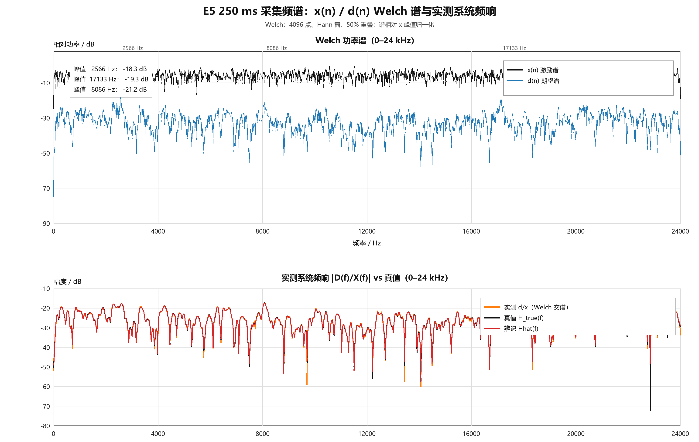
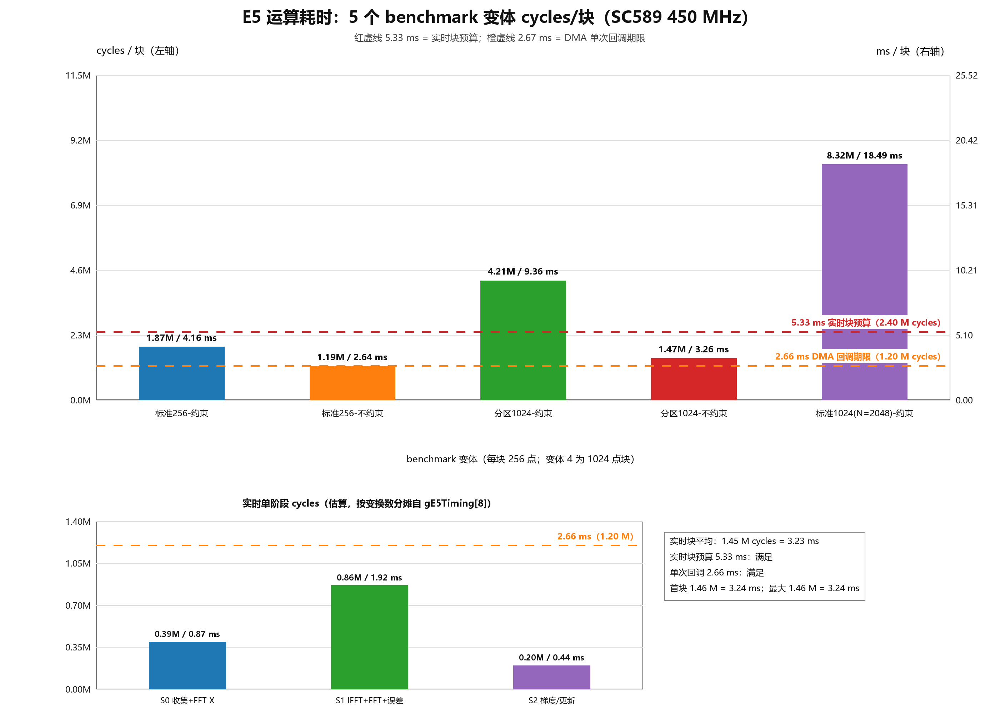

# E5 FDAF 系统辨识：导出数据分析

> 数据目录：`D:\DSP_experiment\E5_FADF\data_part`  
> 图目录：`D:\DSP_experiment\E5_FADF\analysis_figs\data_part`  
> 平台：fs = 48000 Hz，SC589 Core1 450 MHz；1 块 = 256 点 = 5.333 ms；实时块预算 5.33 ms，DMA 单次回调期限 2.67 ms。

## 1 导出数据与实时模式

| 变量 | 状态 |
|---|---|
| `gE5Hhat.dat` | 已读取 |
| `gE5HtrueT.dat` | 已读取 |
| `gE5Timing.dat` | 已读取 |
| `gE5Debug.dat` | 已读取 |
| `gE5BenchMSE.dat` | 已读取 |
| `gE5RtMSE.dat` | 已读取 |
| `gRawCapture.dat` | 已读取 |
| `gProcessedCapture.dat` | 已读取 |
| `gProcessed1024Capture.dat` | 已读取 |

- 实时模式：**进阶（分区 1024 点）**（`gE5Timing[11]` = 1024）
- 约束标志：**不约束**（`gE5Timing[12]` = 0）
- μ = 6.00e-03；实时块数 = 421

## 2 benchmark 变体：耗时与精度

| 变体 | cycles/块 | cycles/点 | ms/块 | 折合 256 点 ms | 满足 5.33 ms | 失配 / dB | 收敛 -20 dB（块 / ms） |
|---|---:|---:|---:|---:|:---:|---:|---:|
| 标准256-约束 | 1,873,923 | 7,320 | 4.16 | 4.16 | 是 | -44.9 | 139 / 741 |
| 标准256-不约束 | 1,187,468 | 4,639 | 2.64 | 2.64 | 是 | — | 140 / 747 |
| 分区1024-约束 | 4,211,026 | 16,449 | 9.36 | 9.36 | **否（1.75× 超时）** | -43.0 | 144 / 768 |
| 分区1024-不约束 | 1,465,178 | 5,723 | 3.26 | 3.26 | 是 | — | 51 / 272 |
| 标准1024(N=2048)-约束 | 8,322,138 | 8,127 | 18.49 | 4.62 | 是* | -22.2 | 140 / 747 |
| ↳ 说明 |  |  |  |  | （块周期 21.33 ms；单次回调算完 18.5 ms > DMA 2.66 ms，不能真机实时） |  |  |

说明：变体 4（标准 1024 点，N=2048）按 1024 点块统计，与 hop=256 的变体不能直接比 cycles/块，故给“折合 256 点 ms”；收敛到 -20 dB 取 10 块滑动平均首次 ≤ -20 dB 的块序号。

## 3 实时链路（S0/S1/S2 分阶段）

| 阶段 | cycles（估算） | ms | 满足 2.66 ms |
|---|---:|---:|:---:|
| S0（收集 + FFT X） | 393,175 | 0.87 | 是 |
| S1（IFFT + FFT，出 y/d/e） | 864,984 | 1.92 | 是 |
| S2（梯度/更新） | 196,587 | 0.44 | 是 |

- 实时块平均：1,454,747 cycles = 3.23 ms （预算 5.33 ms：满足）
- 首块：1,457,899 cycles = 3.24 ms；最大：1,457,899 cycles = 3.24 ms
- 阶段 cycles 无单独导出变量；分区不约束版 S2 只有频域乘加，这里按实测块均值以 1:2.2:0.5 分摊估算（仅作量级参考）。

| gE5Debug | 值 | 含义 |
|---|---:|---|
| `gE5Debug[...]` ProcessBuffers 进入次数 | 1688 | |
| `gE5Debug[...]` 块数 | 421 | |
| `gE5Debug[...]` S0 次数 | 422 | |
| `gE5Debug[...]` S1 次数 | 421 | |
| `gE5Debug[...]` S2 次数 | 421 | |
| `gE5Debug[...]` S3 次数 | 424 | |
| `gE5Debug[...]` AdcCount | 1690 | |
| `gE5Debug[...]` bEventError | 1 | |
| `gE5Debug[...]` gCaptureActive | 0 | |
| `gE5Debug[...]` 采集帧数 | 12000 | |

### 实时学习曲线

- 有效块数 421（2245 ms），末块 MSE = -44.1 dB
- 收敛到 -20 dB：第 51 块（272 ms）

## 4 250 ms 内部采集

| 量 | 值 |
|---|---:|
| rms(x) | 0.29090 |
| rms(d) | 0.01712 |
| rms(e) | 0.000098 |
| e 相对 d 的 RMS 比例 | 0.571 % （-44.9 dB） |
| 峰值 \|d\| / 峰值 \|e\| | 0.0671 / 0.00098 |

说明：三个采集数组均为 DSP 内部 float 信号乘同一缩放系数后存 int16；e 相对 d 的 RMS 比例直接反映实时自适应收敛后的残余误差。

## 5 辨识精度

导出真值对应未知系统：**系统 B（1024 点混响）**。

| 比较范围 | 失配（10log10 Σe²/Σh²） | 峰值相对误差 | 峰值处逐点最大相对误差 | 对齐 lag |
|---|---:|---:|---:|---:|
| 前 256 点 | -35.06 dB | 7.54 % | 44.3 % | 0 点 |
| 前 512 点 | -31.26 dB | 7.54 % | 62.9 % | 0 点 |
| 全 1024 点 | -30.63 dB | 7.54 % | 126.1 % | 0 点 |

幅频响应（`e5_freq_response.png`）：

- 前 256 点（512 点 FFT，对照系统 A 长度）：6 kHz：真值 -24.2 dB / 辨识 -24.2 dB；12 kHz：真值 -31.7 dB / 辨识 -32.0 dB
- 系统 B：全 1024 点（1024 点 FFT）：6 kHz：真值 -25.0 dB / 辨识 -24.9 dB；12 kHz：真值 -31.3 dB / 辨识 -31.2 dB

## 6 图

