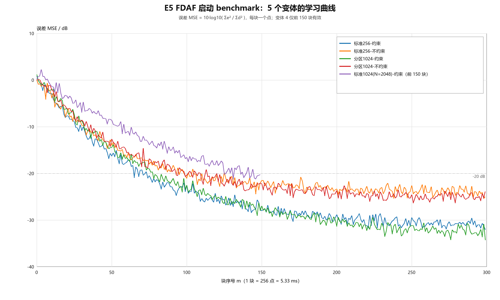
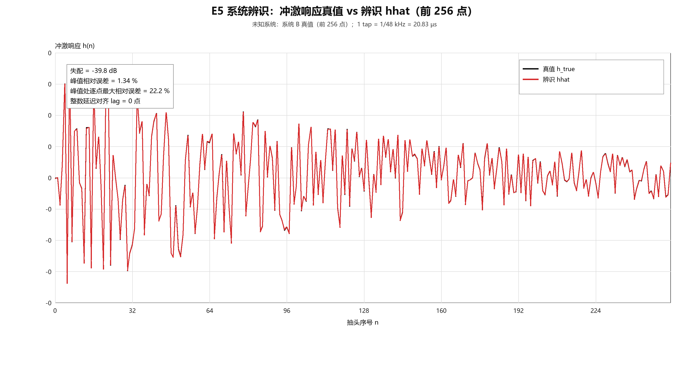
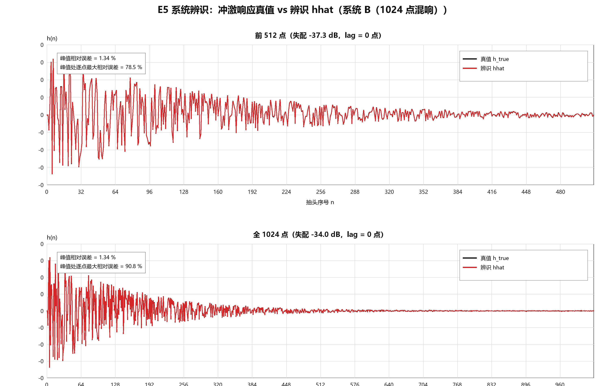
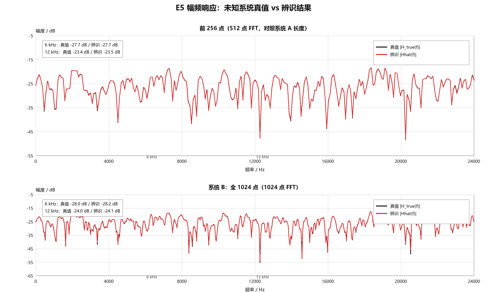
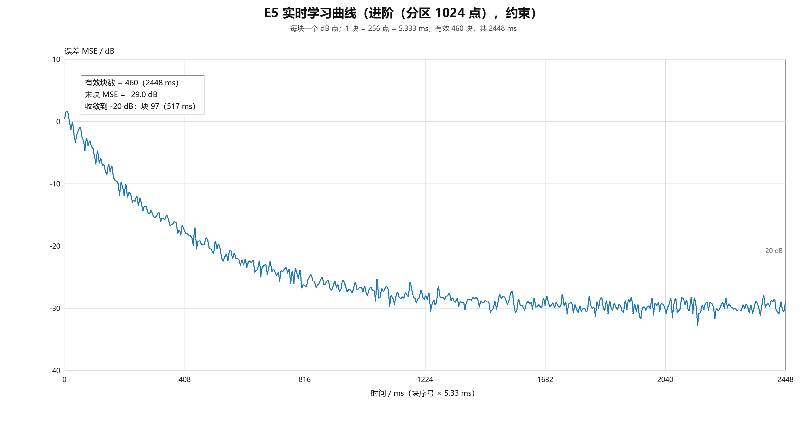
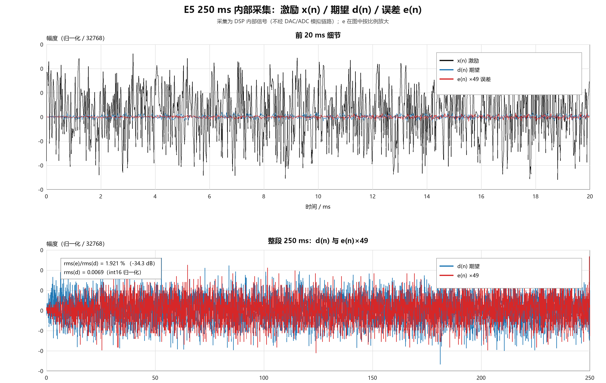
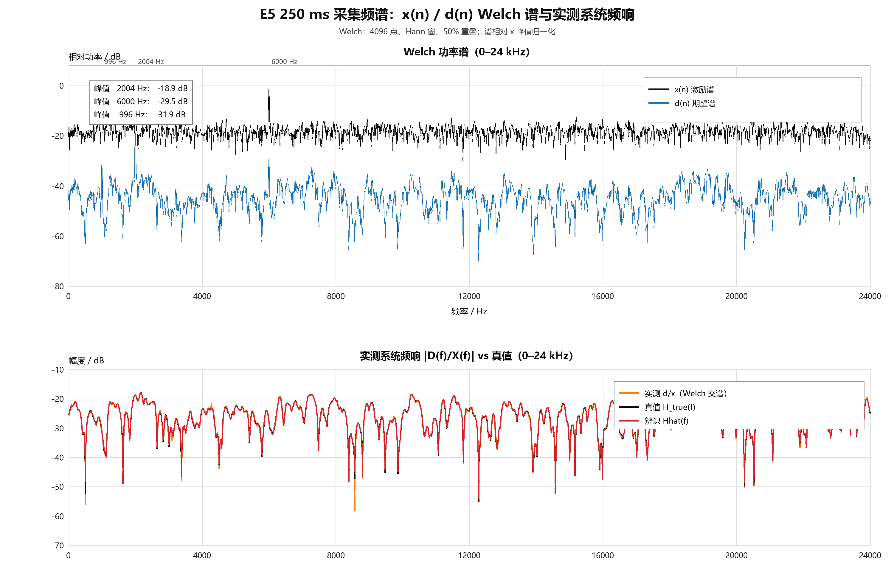
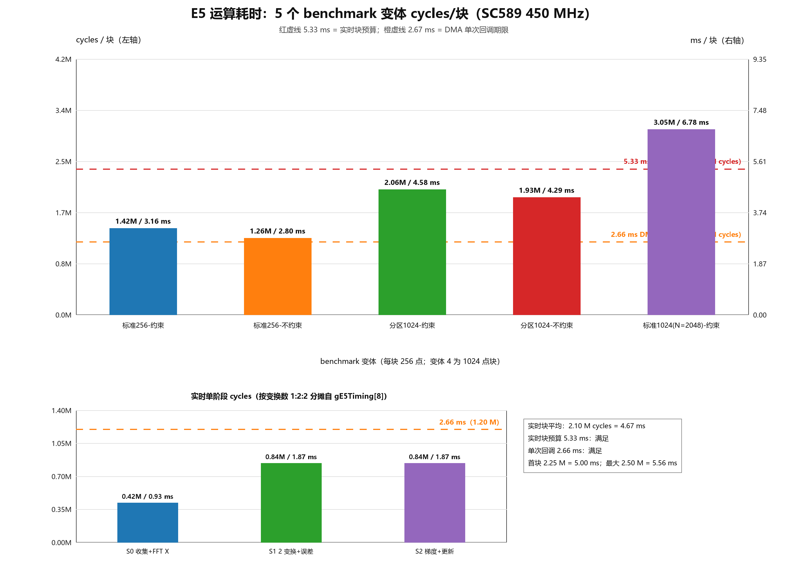

# E5 FDAF 系统辨识：导出数据分析

> 数据目录：`D:\DSP_experiment\E5_FADF\postprocess_test\data`  
> 图目录：`D:\DSP_experiment\E5_FADF\postprocess_test\analysis_figs`  
> 平台：fs = 48000 Hz，SC589 Core1 450 MHz；1 块 = 256 点 = 5.333 ms；实时块预算 5.33 ms，DMA 单次回调期限 2.67 ms。

## 1 导出数据与实时模式

| 变量 | 状态 |
|---|---|
| `gE5Hhat.dat` | 已读取 |
| `gE5HtrueT.dat` | 已读取 |
| `gE5Timing.dat` | 已读取 |
| `gE5Debug.dat` | 已读取 |
| `gE5BenchMSE.dat` | 已读取 |
| `gE5RtMSE.dat` | 已读取 |
| `gRawCapture.dat` | 已读取 |
| `gProcessedCapture.dat` | 已读取 |
| `gProcessed1024Capture.dat` | 已读取 |

- 实时模式：**进阶（分区 1024 点）**（`gE5Timing[11]` = 1024）
- 约束标志：**约束**（`gE5Timing[12]` = 1）
- μ = 1.50e-05；实时块数 = 512；benchmark 完成标志 = 1

## 2 benchmark 变体：耗时与精度

| 变体 | cycles/块 | cycles/点 | ms/块 | 折合 256 点 ms | 满足 5.33 ms | 失配 / dB | 收敛 -20 dB（块 / ms） |
|---|---:|---:|---:|---:|:---:|---:|---:|
| 标准256-约束 | 1,420,000 | 5,547 | 3.16 | 3.16 | 是 | -31.0 | 76 / 405 |
| 标准256-不约束 | 1,260,000 | 4,922 | 2.80 | 2.80 | 是 | — | 102 / 544 |
| 分区1024-约束 | 2,060,000 | 2,012 | 4.58 | 1.14 | 是 | -34.0 | 82 / 437 |
| 分区1024-不约束 | 1,930,000 | 1,885 | 4.29 | 1.07 | 是 | — | 107 / 571 |
| 标准1024(N=2048)-约束 | 3,050,000 | 2,979 | 6.78 | 1.69 | 是（按 4 分区等效） | -30.5 | 145 / 773 |

说明：变体 4（标准 1024 点，N=2048）按 1024 点块统计，与 hop=256 的变体不能直接比 cycles/块，故给“折合 256 点 ms”；收敛到 -20 dB 取 10 块滑动平均首次 ≤ -20 dB 的块序号。

## 3 实时链路（S0/S1/S2 分阶段）

| 阶段 | cycles（估算） | ms | 满足 2.66 ms |
|---|---:|---:|:---:|
| S0（收集 + FFT X） | 420,000 | 0.93 | 是 |
| S1（2 中变换，出 y/d/e） | 840,000 | 1.87 | 是 |
| S2（梯度 + 约束 + 更新） | 840,000 | 1.87 | 是 |

- 实时块平均：2,100,000 cycles = 4.67 ms （预算 5.33 ms：满足）
- 首块：2,250,000 cycles = 5.00 ms；最大：2,500,000 cycles = 5.56 ms
- 阶段 cycles 无单独导出变量，按变换数 1:2:2（S0:S1:S2）从 `gE5Timing[8]` 分摊估算；阶段实测请以 `gE5Debug` 计数为佐证。

| gE5Debug | 值 | 含义 |
|---|---:|---|
| `gE5Debug[...]` ProcessBuffers 进入次数 | 2048 | |
| `gE5Debug[...]` 块数 | 512 | |
| `gE5Debug[...]` S0 次数 | 512 | |
| `gE5Debug[...]` S1 次数 | 512 | |
| `gE5Debug[...]` S2 次数 | 512 | |
| `gE5Debug[...]` S3 次数 | 512 | |
| `gE5Debug[...]` AdcCount | 6000 | |
| `gE5Debug[...]` bEventError | 0 | |
| `gE5Debug[...]` gCaptureActive | 1 | |
| `gE5Debug[...]` 采集帧数 | 12000 | |

### 实时学习曲线

- 有效块数 460（2453 ms），末块 MSE = -29.0 dB
- 收敛到 -20 dB：第 97 块（517 ms）

## 4 250 ms 内部采集

| 量 | 值 |
|---|---:|
| rms(x) | 0.11224 |
| rms(d) | 0.00690 |
| rms(e) | 0.000133 |
| e 相对 d 的 RMS 比例 | 1.921 % （-34.3 dB） |
| 峰值 \|d\| / 峰值 \|e\| | 0.0283 / 0.00058 |

说明：三个采集数组均为 DSP 内部 float 信号乘同一缩放系数后存 int16；e 相对 d 的 RMS 比例直接反映实时自适应收敛后的残余误差。

## 5 辨识精度

导出真值对应未知系统：**系统 B（1024 点混响）**。

| 比较范围 | 失配（10log10 Σe²/Σh²） | 峰值相对误差 | 峰值处逐点最大相对误差 | 对齐 lag |
|---|---:|---:|---:|---:|
| 前 256 点 | -39.83 dB | 1.34 % | 22.2 % | 0 点 |
| 前 512 点 | -37.26 dB | 1.34 % | 78.5 % | 0 点 |
| 全 1024 点 | -33.99 dB | 1.34 % | 90.8 % | 0 点 |

幅频响应（`e5_freq_response.png`）：

- 前 256 点（512 点 FFT，对照系统 A 长度）：6 kHz：真值 -27.7 dB / 辨识 -27.7 dB；12 kHz：真值 -23.4 dB / 辨识 -23.5 dB
- 系统 B：全 1024 点（1024 点 FFT）：6 kHz：真值 -28.0 dB / 辨识 -28.2 dB；12 kHz：真值 -24.0 dB / 辨识 -24.1 dB

## 6 图

